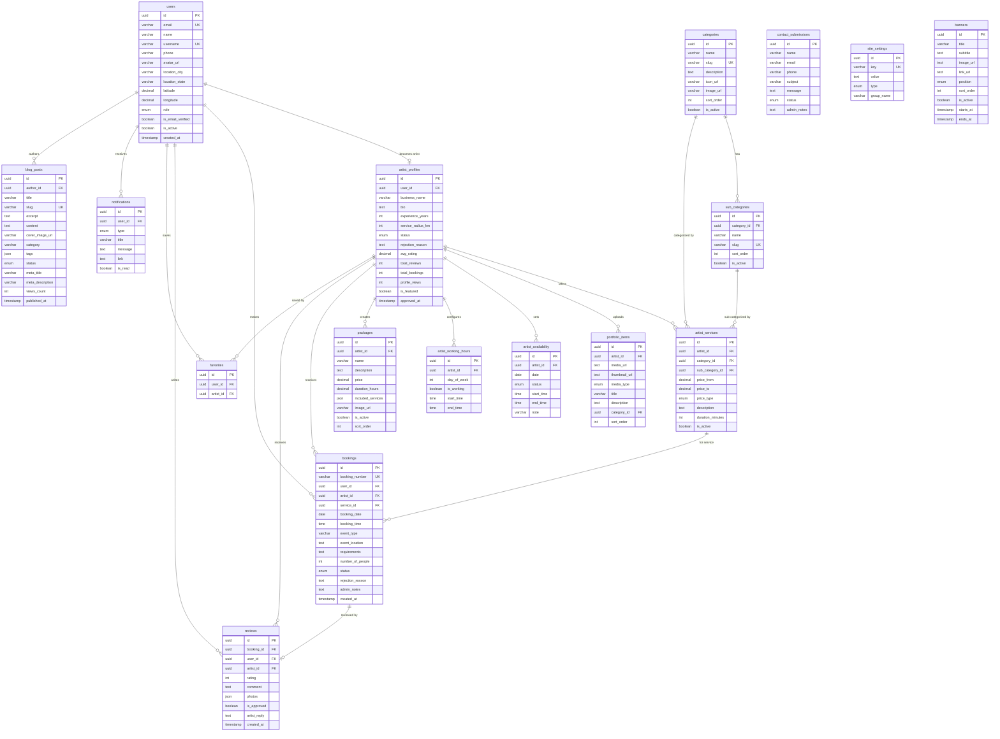
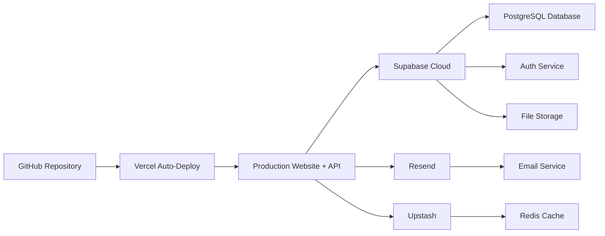

# 📋 GlamBook — PRD Backend

## Database Schema, API Endpoints, Auth, Security & Deployment

---

## 1. Database Schema — 17 Tables

### 1.1 Entity Relationship Diagram



---

### 1.2 Table Definitions (Detailed)

#### Table 1: `users`

| Column | Type | Constraints | Notes |
|--------|------|-------------|-------|
| `id` | UUID | PK, default `gen_random_uuid()` | Maps to Supabase Auth user |
| `email` | VARCHAR(255) | UNIQUE, NOT NULL | |
| `name` | VARCHAR(100) | NOT NULL | |
| `username` | VARCHAR(50) | UNIQUE, NOT NULL | |
| `phone` | VARCHAR(20) | NULLABLE | |
| `avatar_url` | TEXT | NULLABLE | Profile photo URL |
| `location_city` | VARCHAR(100) | NULLABLE | |
| `location_state` | VARCHAR(100) | NULLABLE | |
| `location_country` | VARCHAR(100) | DEFAULT 'India' | |
| `latitude` | DECIMAL(10,8) | NULLABLE | For geo search |
| `longitude` | DECIMAL(11,8) | NULLABLE | For geo search |
| `role` | ENUM | `user`, `artist`, `admin` | |
| `is_email_verified` | BOOLEAN | DEFAULT false | |
| `is_active` | BOOLEAN | DEFAULT true | Admin can deactivate |
| `created_at` | TIMESTAMP | DEFAULT NOW() | |
| `updated_at` | TIMESTAMP | Auto-update | |

#### Table 2: `categories`

| Column | Type | Constraints | Notes |
|--------|------|-------------|-------|
| `id` | UUID | PK | |
| `name` | VARCHAR(100) | NOT NULL | e.g., "Makeup Artist" |
| `slug` | VARCHAR(100) | UNIQUE, NOT NULL | e.g., "makeup-artist" |
| `description` | TEXT | NULLABLE | |
| `icon_url` | TEXT | NULLABLE | Category icon |
| `image_url` | TEXT | NULLABLE | Category banner |
| `sort_order` | INTEGER | DEFAULT 0 | Display order |
| `is_active` | BOOLEAN | DEFAULT true | |
| `created_at` | TIMESTAMP | DEFAULT NOW() | |

#### Table 3: `sub_categories`

| Column | Type | Constraints | Notes |
|--------|------|-------------|-------|
| `id` | UUID | PK | |
| `category_id` | UUID | FK → categories.id, NOT NULL | |
| `name` | VARCHAR(100) | NOT NULL | e.g., "Bridal Makeup" |
| `slug` | VARCHAR(100) | UNIQUE, NOT NULL | |
| `description` | TEXT | NULLABLE | |
| `sort_order` | INTEGER | DEFAULT 0 | |
| `is_active` | BOOLEAN | DEFAULT true | |
| `created_at` | TIMESTAMP | DEFAULT NOW() | |

#### Table 4: `artist_profiles`

| Column | Type | Constraints | Notes |
|--------|------|-------------|-------|
| `id` | UUID | PK | |
| `user_id` | UUID | FK → users.id, UNIQUE, NOT NULL | One-to-one with user |
| `business_name` | VARCHAR(150) | NULLABLE | Optional business name |
| `bio` | TEXT | NULLABLE | About the artist |
| `experience_years` | INTEGER | DEFAULT 0 | |
| `service_radius_km` | INTEGER | DEFAULT 10 | How far they travel |
| `status` | ENUM | `pending`, `approved`, `rejected`, `suspended` | Admin controls |
| `rejection_reason` | TEXT | NULLABLE | Why admin rejected |
| `avg_rating` | DECIMAL(2,1) | DEFAULT 0.0 | Calculated field |
| `total_reviews` | INTEGER | DEFAULT 0 | Calculated field |
| `total_bookings` | INTEGER | DEFAULT 0 | Calculated field |
| `profile_views` | INTEGER | DEFAULT 0 | Analytics |
| `is_featured` | BOOLEAN | DEFAULT false | Admin can feature |
| `approved_at` | TIMESTAMP | NULLABLE | When admin approved |
| `created_at` | TIMESTAMP | DEFAULT NOW() | |
| `updated_at` | TIMESTAMP | Auto-update | |

#### Table 5: `artist_services`

| Column | Type | Constraints | Notes |
|--------|------|-------------|-------|
| `id` | UUID | PK | |
| `artist_id` | UUID | FK → artist_profiles.id | |
| `category_id` | UUID | FK → categories.id | |
| `sub_category_id` | UUID | FK → sub_categories.id | |
| `price_from` | DECIMAL(10,2) | NOT NULL | Starting price |
| `price_to` | DECIMAL(10,2) | NULLABLE | Max price (if range) |
| `price_type` | ENUM | `fixed`, `starting_from`, `range`, `negotiable` | |
| `description` | TEXT | NULLABLE | Service-specific details |
| `duration_minutes` | INTEGER | NULLABLE | How long the service takes |
| `is_active` | BOOLEAN | DEFAULT true | |
| `created_at` | TIMESTAMP | DEFAULT NOW() | |

#### Table 6: `portfolio_items`

| Column | Type | Constraints | Notes |
|--------|------|-------------|-------|
| `id` | UUID | PK | |
| `artist_id` | UUID | FK → artist_profiles.id | |
| `media_url` | TEXT | NOT NULL | Image/video URL |
| `thumbnail_url` | TEXT | NULLABLE | Auto-generated thumbnail |
| `media_type` | ENUM | `image`, `video` | |
| `title` | VARCHAR(200) | NULLABLE | |
| `description` | TEXT | NULLABLE | |
| `category_id` | UUID | FK → categories.id, NULLABLE | Organize by service type |
| `sort_order` | INTEGER | DEFAULT 0 | |
| `created_at` | TIMESTAMP | DEFAULT NOW() | |

#### Table 7: `artist_availability`

| Column | Type | Constraints | Notes |
|--------|------|-------------|-------|
| `id` | UUID | PK | |
| `artist_id` | UUID | FK → artist_profiles.id | |
| `date` | DATE | NOT NULL | Specific date |
| `status` | ENUM | `available`, `booked`, `blocked` | |
| `start_time` | TIME | NULLABLE | If partial day |
| `end_time` | TIME | NULLABLE | If partial day |
| `note` | VARCHAR(255) | NULLABLE | e.g., "Morning only" |
| `created_at` | TIMESTAMP | DEFAULT NOW() | |
| **UNIQUE** | `(artist_id, date)` | | One entry per date per artist |

#### Table 8: `artist_working_hours`

| Column | Type | Constraints | Notes |
|--------|------|-------------|-------|
| `id` | UUID | PK | |
| `artist_id` | UUID | FK → artist_profiles.id | |
| `day_of_week` | INTEGER | 0-6 (Sun-Sat) | |
| `is_working` | BOOLEAN | DEFAULT true | |
| `start_time` | TIME | DEFAULT '09:00' | |
| `end_time` | TIME | DEFAULT '18:00' | |

#### Table 9: `bookings`

| Column | Type | Constraints | Notes |
|--------|------|-------------|-------|
| `id` | UUID | PK | |
| `booking_number` | VARCHAR(20) | UNIQUE, NOT NULL | e.g., "GB-20261001-001" |
| `user_id` | UUID | FK → users.id | |
| `artist_id` | UUID | FK → artist_profiles.id | |
| `service_id` | UUID | FK → artist_services.id | |
| `booking_date` | DATE | NOT NULL | Requested date |
| `booking_time` | TIME | NULLABLE | Preferred time |
| `event_type` | VARCHAR(100) | NULLABLE | e.g., "Wedding", "Party" |
| `event_location` | TEXT | NULLABLE | Where the event is |
| `requirements` | TEXT | NULLABLE | User's special requests |
| `number_of_people` | INTEGER | DEFAULT 1 | How many people need service |
| `status` | ENUM | `pending`, `accepted`, `rejected`, `completed`, `cancelled` | |
| `rejection_reason` | TEXT | NULLABLE | If artist/admin rejects |
| `admin_notes` | TEXT | NULLABLE | Internal admin notes |
| `created_at` | TIMESTAMP | DEFAULT NOW() | |
| `updated_at` | TIMESTAMP | Auto-update | |

#### Table 10: `reviews`

| Column | Type | Constraints | Notes |
|--------|------|-------------|-------|
| `id` | UUID | PK | |
| `booking_id` | UUID | FK → bookings.id, UNIQUE | One review per booking |
| `user_id` | UUID | FK → users.id | |
| `artist_id` | UUID | FK → artist_profiles.id | |
| `rating` | INTEGER | CHECK 1-5 | Star rating |
| `comment` | TEXT | NULLABLE | Review text |
| `photos` | JSON | NULLABLE | Array of image URLs |
| `is_approved` | BOOLEAN | DEFAULT true | Admin can moderate |
| `artist_reply` | TEXT | NULLABLE | Artist's response |
| `artist_reply_at` | TIMESTAMP | NULLABLE | |
| `created_at` | TIMESTAMP | DEFAULT NOW() | |

#### Table 11: `packages`

| Column | Type | Constraints | Notes |
|--------|------|-------------|-------|
| `id` | UUID | PK | |
| `artist_id` | UUID | FK → artist_profiles.id | |
| `name` | VARCHAR(200) | NOT NULL | e.g., "Bridal Deluxe" |
| `description` | TEXT | NOT NULL | What's included |
| `price` | DECIMAL(10,2) | NOT NULL | Package price |
| `duration_hours` | DECIMAL(4,1) | NULLABLE | Total duration |
| `included_services` | JSON | NOT NULL | Array of service IDs/names |
| `image_url` | TEXT | NULLABLE | Package cover image |
| `is_active` | BOOLEAN | DEFAULT true | |
| `sort_order` | INTEGER | DEFAULT 0 | |
| `created_at` | TIMESTAMP | DEFAULT NOW() | |

#### Table 12: `favorites`

| Column | Type | Constraints | Notes |
|--------|------|-------------|-------|
| `id` | UUID | PK | |
| `user_id` | UUID | FK → users.id | |
| `artist_id` | UUID | FK → artist_profiles.id | |
| `created_at` | TIMESTAMP | DEFAULT NOW() | |
| **UNIQUE** | `(user_id, artist_id)` | | No duplicates |

#### Table 13: `blog_posts`

| Column | Type | Constraints | Notes |
|--------|------|-------------|-------|
| `id` | UUID | PK | |
| `author_id` | UUID | FK → users.id | Admin who wrote it |
| `title` | VARCHAR(300) | NOT NULL | |
| `slug` | VARCHAR(300) | UNIQUE, NOT NULL | SEO URL |
| `excerpt` | TEXT | NULLABLE | Short summary |
| `content` | TEXT | NOT NULL | Full HTML/Markdown content |
| `cover_image_url` | TEXT | NULLABLE | |
| `category` | VARCHAR(100) | NULLABLE | Blog category |
| `tags` | JSON | NULLABLE | Array of tag strings |
| `status` | ENUM | `draft`, `published` | |
| `meta_title` | VARCHAR(200) | NULLABLE | SEO |
| `meta_description` | VARCHAR(500) | NULLABLE | SEO |
| `views_count` | INTEGER | DEFAULT 0 | |
| `published_at` | TIMESTAMP | NULLABLE | |
| `created_at` | TIMESTAMP | DEFAULT NOW() | |
| `updated_at` | TIMESTAMP | Auto-update | |

#### Table 14: `contact_submissions`

| Column | Type | Constraints | Notes |
|--------|------|-------------|-------|
| `id` | UUID | PK | |
| `name` | VARCHAR(100) | NOT NULL | |
| `email` | VARCHAR(255) | NOT NULL | |
| `phone` | VARCHAR(20) | NULLABLE | |
| `subject` | VARCHAR(300) | NOT NULL | |
| `message` | TEXT | NOT NULL | |
| `status` | ENUM | `new`, `read`, `replied`, `archived` | |
| `admin_notes` | TEXT | NULLABLE | |
| `created_at` | TIMESTAMP | DEFAULT NOW() | |

#### Table 15: `notifications`

| Column | Type | Constraints | Notes |
|--------|------|-------------|-------|
| `id` | UUID | PK | |
| `user_id` | UUID | FK → users.id | Recipient |
| `type` | ENUM | `booking_new`, `booking_accepted`, `booking_rejected`, `artist_approved`, `artist_rejected`, `review_received`, `system` | |
| `title` | VARCHAR(200) | NOT NULL | |
| `message` | TEXT | NOT NULL | |
| `link` | TEXT | NULLABLE | Click-through URL |
| `is_read` | BOOLEAN | DEFAULT false | |
| `created_at` | TIMESTAMP | DEFAULT NOW() | |

#### Table 16: `site_settings`

| Column | Type | Constraints | Notes |
|--------|------|-------------|-------|
| `id` | UUID | PK | |
| `key` | VARCHAR(100) | UNIQUE, NOT NULL | e.g., "site_name", "logo_url" |
| `value` | TEXT | NOT NULL | Setting value |
| `type` | ENUM | `text`, `image`, `boolean`, `json` | Value type |
| `group` | VARCHAR(50) | DEFAULT 'general' | Setting group |
| `updated_at` | TIMESTAMP | Auto-update | |

#### Table 17: `banners`

| Column | Type | Constraints | Notes |
|--------|------|-------------|-------|
| `id` | UUID | PK | |
| `title` | VARCHAR(200) | NULLABLE | Banner heading |
| `subtitle` | TEXT | NULLABLE | Banner subtext |
| `image_url` | TEXT | NOT NULL | Banner image |
| `link_url` | TEXT | NULLABLE | Click destination |
| `position` | ENUM | `home_hero`, `home_middle`, `find_artist_top` | Where it shows |
| `sort_order` | INTEGER | DEFAULT 0 | |
| `is_active` | BOOLEAN | DEFAULT true | |
| `starts_at` | TIMESTAMP | NULLABLE | Scheduled display |
| `ends_at` | TIMESTAMP | NULLABLE | Auto-expire |
| `created_at` | TIMESTAMP | DEFAULT NOW() | |

---

### 1.3 Database Indexes

| Table | Index | Purpose |
|-------|-------|---------|
| `artist_profiles` | `(status, location_city)` via users join | Fast filtered artist search |
| `artist_services` | `(artist_id, category_id, sub_category_id)` | Service lookups |
| `artist_availability` | `(artist_id, date)` UNIQUE | Calendar queries |
| `bookings` | `(user_id, status)` | User booking list |
| `bookings` | `(artist_id, status)` | Artist booking list |
| `portfolio_items` | `(artist_id, sort_order)` | Portfolio display |
| `reviews` | `(artist_id, created_at)` | Review listing |
| `blog_posts` | `(status, published_at)` | Blog listing |
| `notifications` | `(user_id, is_read)` | Notification queries |
| `categories` | `(is_active, sort_order)` | Category listing |

---

## 2. Auth System

### 2.1 Auth Endpoints

| Method | Endpoint | Description | Access |
|--------|----------|-------------|--------|
| POST | `/api/auth/signup` | Register new user or artist | Public |
| POST | `/api/auth/login` | Login with email + password | Public |
| POST | `/api/auth/logout` | Logout, clear session | Authenticated |
| POST | `/api/auth/verify-email` | Verify email via token from link | Public |
| POST | `/api/auth/resend-verification` | Resend verification email | Public |
| POST | `/api/auth/forgot-password` | Send password reset email | Public |
| POST | `/api/auth/reset-password` | Reset password with token | Public |
| GET | `/api/auth/me` | Get current user profile | Authenticated |

### 2.2 Auth Middleware

| Middleware | Purpose |
|-----------|---------|
| `withAuth` | Verify Supabase JWT token is valid, extract user |
| `withRole('admin')` | Check user has admin role |
| `withRole('artist')` | Check user has artist role |
| `withRole('user')` | Check user has user role |
| `withVerifiedEmail` | Check email is verified |

---

## 3. API Endpoints — Complete Reference

### 3.1 Public Website APIs (No Auth)

| Method | Endpoint | Description |
|--------|----------|-------------|
| GET | `/api/artists` | Search/filter artists (approved only) |
| GET | `/api/artists/[slug]` | Get artist public profile |
| GET | `/api/artists/[slug]/portfolio` | Get artist portfolio |
| GET | `/api/artists/[slug]/reviews` | Get artist reviews |
| GET | `/api/artists/[slug]/availability` | Get artist availability calendar |
| GET | `/api/artists/[slug]/packages` | Get artist packages |
| GET | `/api/artists/featured` | Get featured artists |
| GET | `/api/categories` | Get all active categories with sub-categories |
| GET | `/api/packages` | Get all packages (with filters) |
| GET | `/api/blog` | Get published blog posts |
| GET | `/api/blog/[slug]` | Get single blog post |
| POST | `/api/contact` | Submit contact form |
| GET | `/api/testimonials` | Get active testimonials |
| GET | `/api/banners` | Get active banners by position |
| GET | `/api/site-settings` | Get public site settings |
| GET | `/api/stats` | Get platform statistics |

### 3.2 User Portal APIs (Requires `user` role)

| Method | Endpoint | Description |
|--------|----------|-------------|
| GET | `/api/user/profile` | Get own profile |
| PUT | `/api/user/profile` | Update profile |
| PUT | `/api/user/profile/password` | Change password |
| DELETE | `/api/user/profile` | Delete account |
| POST | `/api/bookings` | Create booking request |
| GET | `/api/user/bookings` | List own bookings |
| GET | `/api/user/bookings/[id]` | Get booking details |
| PATCH | `/api/user/bookings/[id]/cancel` | Cancel booking |
| POST | `/api/reviews` | Submit a review |
| GET | `/api/user/favorites` | List saved artists |
| POST | `/api/user/favorites/[artistId]` | Add to favorites |
| DELETE | `/api/user/favorites/[artistId]` | Remove from favorites |
| GET | `/api/user/notifications` | List notifications |
| PATCH | `/api/user/notifications/read-all` | Mark all read |
| PATCH | `/api/user/notifications/[id]/read` | Mark one as read |

### 3.3 Artist Portal APIs (Requires `artist` role)

| Method | Endpoint | Description |
|--------|----------|-------------|
| GET | `/api/artist/profile` | Get own profile |
| PUT | `/api/artist/profile` | Update profile |
| POST | `/api/artist/onboarding` | Submit full onboarding data |
| POST | `/api/artist/portfolio` | Upload portfolio item |
| DELETE | `/api/artist/portfolio/[id]` | Delete portfolio item |
| PUT | `/api/artist/portfolio/reorder` | Reorder portfolio |
| GET | `/api/artist/services` | List own services |
| POST | `/api/artist/services` | Add new service |
| PUT | `/api/artist/services/[id]` | Update service |
| DELETE | `/api/artist/services/[id]` | Delete service |
| GET | `/api/artist/availability` | Get calendar data |
| POST | `/api/artist/availability` | Set availability for dates |
| PUT | `/api/artist/working-hours` | Update weekly schedule |
| GET | `/api/artist/bookings` | List own booking requests |
| PATCH | `/api/artist/bookings/[id]/accept` | Accept booking |
| PATCH | `/api/artist/bookings/[id]/reject` | Reject booking with reason |
| PATCH | `/api/artist/bookings/[id]/complete` | Mark booking completed |
| GET | `/api/artist/packages` | List own packages |
| POST | `/api/artist/packages` | Create package |
| PUT | `/api/artist/packages/[id]` | Update package |
| DELETE | `/api/artist/packages/[id]` | Delete package |
| GET | `/api/artist/reviews` | List reviews received |
| POST | `/api/artist/reviews/[id]/reply` | Reply to a review |
| GET | `/api/artist/stats` | Dashboard statistics |

### 3.4 Admin Panel APIs (Requires `admin` role)

#### Category Management

| Method | Endpoint | Description |
|--------|----------|-------------|
| GET | `/api/admin/categories` | List all categories with sub-category count |
| POST | `/api/admin/categories` | Create new category |
| GET | `/api/admin/categories/[id]` | Get single category with sub-categories |
| PUT | `/api/admin/categories/[id]` | Update category |
| DELETE | `/api/admin/categories/[id]` | Delete category (if no artists use it) |
| PATCH | `/api/admin/categories/[id]/toggle` | Toggle active status |
| PUT | `/api/admin/categories/reorder` | Update sort order |
| POST | `/api/admin/categories/[id]/sub-categories` | Create sub-category |
| PUT | `/api/admin/sub-categories/[id]` | Update sub-category |
| DELETE | `/api/admin/sub-categories/[id]` | Delete sub-category |

#### Artist Management

| Method | Endpoint | Description |
|--------|----------|-------------|
| GET | `/api/admin/artists` | List artists with filters, search, pagination |
| GET | `/api/admin/artists/[id]` | Get full artist details |
| PATCH | `/api/admin/artists/[id]/approve` | Approve artist |
| PATCH | `/api/admin/artists/[id]/reject` | Reject artist with reason |
| PATCH | `/api/admin/artists/[id]/suspend` | Suspend artist |
| PATCH | `/api/admin/artists/[id]/feature` | Toggle featured status |
| DELETE | `/api/admin/artists/[id]` | Delete artist account |
| GET | `/api/admin/artists/pending/count` | Get pending approval count |

#### User Management

| Method | Endpoint | Description |
|--------|----------|-------------|
| GET | `/api/admin/users` | List users with search, filters, pagination |
| GET | `/api/admin/users/[id]` | Get full user details |
| PATCH | `/api/admin/users/[id]/toggle-status` | Activate/deactivate user |
| DELETE | `/api/admin/users/[id]` | Delete user account |

#### Booking Management

| Method | Endpoint | Description |
|--------|----------|-------------|
| GET | `/api/admin/bookings` | List all bookings with full user details |
| GET | `/api/admin/bookings/[id]` | Get single booking with all user + artist details |
| PATCH | `/api/admin/bookings/[id]/status` | Update booking status |
| PATCH | `/api/admin/bookings/[id]/notes` | Add/update admin notes |

#### Blog Management

| Method | Endpoint | Description |
|--------|----------|-------------|
| GET | `/api/admin/blog` | List all posts |
| POST | `/api/admin/blog` | Create new post |
| GET | `/api/admin/blog/[id]` | Get single post |
| PUT | `/api/admin/blog/[id]` | Update post |
| DELETE | `/api/admin/blog/[id]` | Delete post |
| PATCH | `/api/admin/blog/[id]/publish` | Toggle publish status |

#### Content & Settings

| Method | Endpoint | Description |
|--------|----------|-------------|
| GET | `/api/admin/banners` | List all banners |
| POST | `/api/admin/banners` | Create banner |
| PUT | `/api/admin/banners/[id]` | Update banner |
| DELETE | `/api/admin/banners/[id]` | Delete banner |
| GET | `/api/admin/testimonials` | List testimonials |
| POST | `/api/admin/testimonials` | Create testimonial |
| PUT | `/api/admin/testimonials/[id]` | Update testimonial |
| DELETE | `/api/admin/testimonials/[id]` | Delete testimonial |
| GET | `/api/admin/settings` | Get all settings |
| PUT | `/api/admin/settings` | Update settings |
| GET | `/api/admin/contact-submissions` | List contact form submissions |
| PATCH | `/api/admin/contact-submissions/[id]` | Update submission status/notes |
| GET | `/api/admin/reviews` | List all reviews for moderation |
| PATCH | `/api/admin/reviews/[id]/toggle` | Approve/flag review |
| GET | `/api/admin/dashboard/stats` | Get dashboard statistics |

---

## 4. Backend Core Utilities

| Utility | Purpose |
|---------|---------|
| **API Response Helper** | Standardized JSON response: `{ success: boolean, data: any, error: string, meta: { page, limit, total } }` |
| **Error Handler** | Global error handling with proper HTTP codes (400, 401, 403, 404, 500) |
| **Validation Layer** | Zod schemas for all request body/query validation |
| **Auth Middleware** | Verify Supabase JWT, extract user role, protect routes |
| **Role Guard** | Middleware to check `user`, `artist`, `admin` access per route |
| **File Upload** | Handle image/video uploads to Supabase Storage, validate type/size |
| **Email Service** | Wrapper around Resend for templated emails |
| **Slug Generator** | Auto-generate URL slugs from names |
| **Pagination Helper** | Reusable offset pagination for list endpoints |
| **Search Builder** | Build PostgreSQL full-text search queries |
| **Notification Creator** | Helper to create notifications + send emails |
| **Booking Number Generator** | Generate unique booking numbers (GB-YYYYMMDD-NNN) |

---

## 5. Email Templates

| Email | Trigger | Recipient |
|-------|---------|-----------|
| **Welcome** | After signup | User / Artist |
| **Verify Email** | After signup | User / Artist |
| **Password Reset** | Forgot password | User / Artist |
| **Artist Approved** | Admin approves artist | Artist |
| **Artist Rejected** | Admin rejects artist | Artist |
| **Booking Received** | User creates booking | Artist + Admin |
| **Booking Accepted** | Artist accepts booking | User |
| **Booking Rejected** | Artist rejects booking | User |
| **Booking Cancelled** | User cancels booking | Artist + Admin |
| **Booking Completed** | Artist marks complete | User |
| **New Review** | User submits review | Artist |
| **Contact Form** | Someone submits contact | Admin |

---

## 6. Security Requirements

| Requirement | Implementation |
|-------------|---------------|
| **Authentication** | Supabase Auth (JWT tokens, session management) |
| **Authorization** | Role-based middleware on every API route |
| **Data Privacy** | Artist booking view NEVER exposes user email/phone |
| **Input Validation** | Zod schemas on all inputs |
| **File Security** | Type whitelist (JPG, PNG, WebP, MP4, MOV), size limits (10MB image, 100MB video), filename sanitization |
| **Rate Limiting** | 100 req/min general, 5/min auth endpoints, 3/hour contact form |
| **Encryption** | HTTPS everywhere, passwords hashed (bcrypt via Supabase) |
| **CSRF** | SameSite cookies + CSRF tokens |
| **XSS** | React auto-escaping + Content Security Policy headers |
| **SQL Injection** | Prisma ORM parameterized queries |
| **Headers** | CSP, X-Frame-Options, X-Content-Type-Options, Strict-Transport-Security |
| **CORS** | Configure allowed origins |

---

## 7. Deployment Architecture



| Environment | Purpose |
|-------------|---------|
| **Development** | Local Next.js dev server + Supabase local or dev project |
| **Staging** | Vercel preview deployments (auto on PR) |
| **Production** | Vercel production + Supabase production project |

---

## 8. Seed Data for Launch

### Default Admin Account

```
Email: admin@glambook.com
Password: [secure password]
Role: admin
```

### Default Categories & Sub-Categories

| Category | Sub-Categories |
|----------|---------------|
| Makeup Artist | Bridal Makeup, Groom Makeup, Party Makeup, Engagement Makeup, HD/Airbrush Makeup |
| Hair Stylist | Bridal Hair, Hair Coloring, Hair Extensions, Hair Spa |
| Mehndi Artist | Bridal Mehndi, Arabic Mehndi, Rajasthani Mehndi, Minimal Mehndi |
| Nail Artist | Nail Art, Gel/Acrylic Nails, Bridal Nails, Pedicure & Manicure |
| Beauty & Skin Care | Facial & Cleanup, Body Polishing, Waxing & Threading, Pre-Bridal Package |
| Photographer | Wedding Photography, Pre-Wedding Shoot, Bridal Portrait, Event Photography, Fashion/Portfolio Shoot |

---

## 9. Performance Targets

| Metric | Target |
|--------|--------|
| **Page Load (LCP)** | < 2 seconds |
| **API Response Time** | < 200ms (simple), < 500ms (complex queries) |
| **Lighthouse Performance** | > 90 |
| **Lighthouse SEO** | > 90 |
| **Uptime** | 99.9% |
| **Database Query** | < 100ms average |
| **Image Load** | Lazy loaded, WebP format, responsive sizes |
