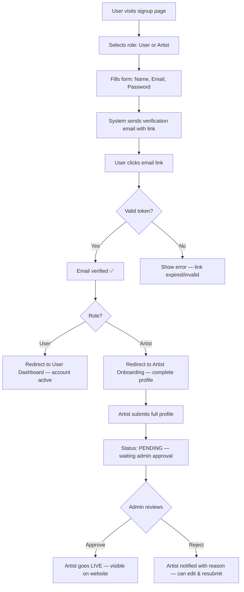
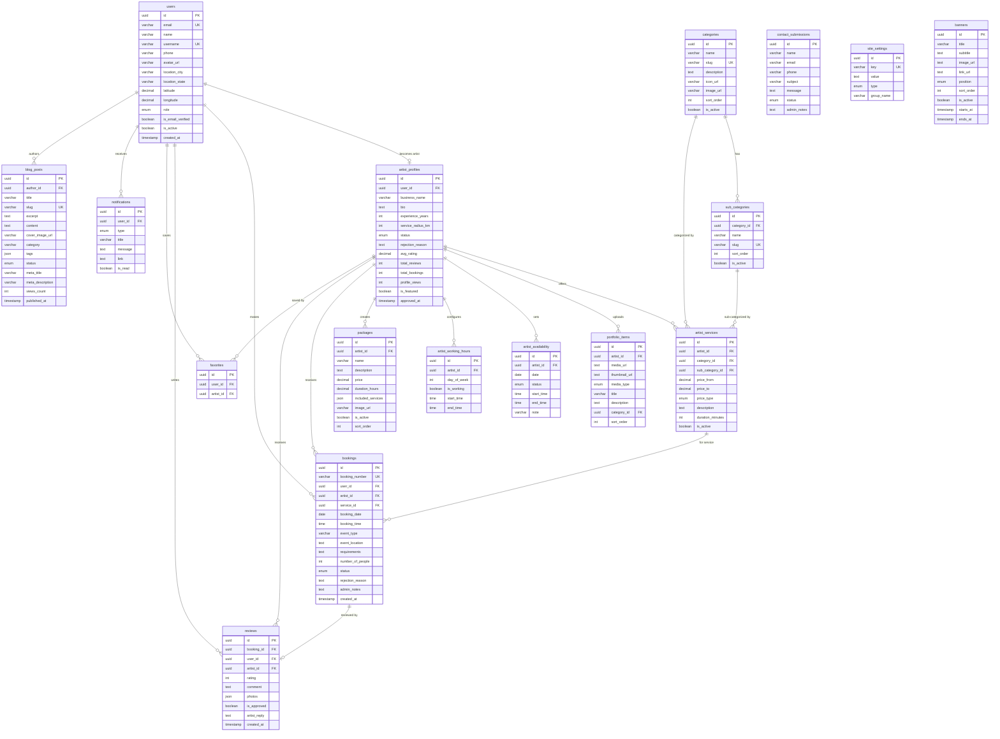
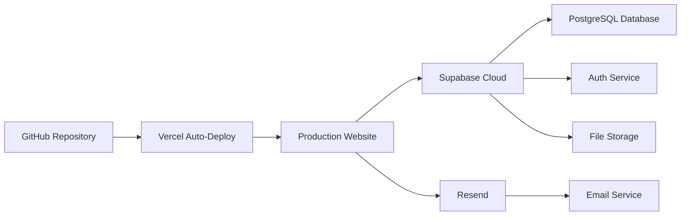

# 📋 GlamBook — Full Product Requirements Document (PRD)

## Makeup Artist & Photography Listing Platform

**Version**: 1.0  
**Date**: September 29, 2026  
**Status**: Draft — Awaiting Approval

---

## Table of Contents

1. [Product Overview](#1-product-overview)
2. [Tech Stack](#2-tech-stack)
3. [User Roles & Permissions](#3-user-roles--permissions)
4. [Phase 1 — Foundation & Backend Core](#phase-1--foundation--backend-core-week-1-2)
5. [Phase 2 — Admin Panel](#phase-2--admin-panel-week-3-4)
6. [Phase 3 — Artist Portal](#phase-3--artist-portal-week-5-6)
7. [Phase 4 — User Portal](#phase-4--user-portal-week-7-8)
8. [Phase 5 — Public Website](#phase-5--public-website-frontend-week-9-11)
9. [Phase 6 — Integration, Polish & Launch](#phase-6--integration-polish--launch-week-12-14)
10. [Database Schema](#10-database-schema)
11. [API Endpoints Reference](#11-api-endpoints-reference)
12. [Security Requirements](#12-security-requirements)
13. [Deployment Plan](#13-deployment-plan)

---

## 1. Product Overview

### 1.1 What Is GlamBook?

GlamBook is a listing & discovery platform where:
- **Artists** (Makeup Artists, Photographers, etc.) register, showcase portfolios, set availability, and receive booking requests
- **Users** search, filter, view artist profiles/portfolios, and send booking requests
- **Admin** controls everything — approves artists, manages categories, receives full booking details, and acts as the middleman between users and artists

### 1.2 Core Business Rules

| Rule | Details |
|------|---------|
| **No Payment Integration** | No online payments. Admin controls leads manually |
| **Lead Protection** | Artist receives booking request with user name + requirements only — **NO user contact info** |
| **Admin Gets Full Data** | Admin receives complete user details (name, email, phone, location) + booking requirements |
| **Artist Approval** | Every artist must be approved by admin before going live |
| **Category Control** | Only admin creates/manages categories and sub-categories |
| **Auth Method** | Email + Password with email verification link (no OTP, no social login) |

### 1.3 Platform Structure

```
GlamBook
├── 🌐 Public Website (No login required to browse)
│   ├── Home
│   ├── Find Artist
│   ├── Packages
│   ├── How It Works
│   ├── About Us
│   ├── Contact Us
│   └── Blog
│
├── 👤 User Portal (Login required)
│   ├── Dashboard
│   ├── My Bookings
│   ├── Favorites
│   ├── Profile Settings
│   └── Notifications
│
├── 🎨 Artist Portal (Login required + Admin approved)
│   ├── Dashboard
│   ├── Profile & Portfolio Management
│   ├── Services & Pricing
│   ├── Availability Calendar
│   ├── Booking Requests
│   ├── Packages
│   └── Reviews
│
└── 🛡️ Admin Panel (Super admin login)
    ├── Dashboard & Analytics
    ├── Artist Management (Approve/Reject/Suspend)
    ├── User Management
    ├── Category & Sub-Category Management
    ├── Booking Management
    ├── Content Management (Blog, Banners, Pages)
    ├── Reviews Moderation
    └── Platform Settings
```

---

## 2. Tech Stack

| Layer | Technology | Purpose |
|-------|-----------|---------|
| **Framework** | Next.js 15 (App Router) | Full-stack — SSR website + API + Portals |
| **Language** | TypeScript | Type safety across entire codebase |
| **Styling** | Tailwind CSS v4 + shadcn/ui | Modern, premium UI |
| **Database** | PostgreSQL via Supabase | Relational data, geo-queries, auth |
| **ORM** | Prisma | Type-safe database access, migrations |
| **Auth** | Supabase Auth | Email + password, email verification |
| **File Storage** | Supabase Storage or Cloudinary | Portfolio images, documents |
| **Search** | PostgreSQL Full-Text Search (MVP) → Meilisearch (later) | Artist search & filtering |
| **Calendar** | FullCalendar (frontend) + custom backend | Availability management |
| **Maps** | Google Maps API or Leaflet (free) | Location display & search |
| **Email** | Resend | Email verification, booking notifications |
| **Hosting** | Vercel | Frontend + API deployment |
| **Cache** | Upstash Redis | Session cache, rate limiting |

---

## 3. User Roles & Permissions

### 3.1 Role Matrix

| Action | Public | User | Artist | Admin |
|--------|--------|------|--------|-------|
| Browse website & artist profiles | ✅ | ✅ | ✅ | ✅ |
| View portfolio & reviews | ✅ | ✅ | ✅ | ✅ |
| Register / Login | ✅ | ✅ | ✅ | ✅ |
| Send booking request | ❌ | ✅ | ❌ | ✅ |
| Save favorite artists | ❌ | ✅ | ❌ | ❌ |
| Create/edit own profile | ❌ | ✅ | ✅ | ✅ |
| Manage portfolio | ❌ | ❌ | ✅ | ✅ |
| Set availability | ❌ | ❌ | ✅ | ✅ |
| View booking (limited - no user contact) | ❌ | ❌ | ✅ | ✅ |
| View booking (full details) | ❌ | ❌ | ❌ | ✅ |
| Approve/reject artists | ❌ | ❌ | ❌ | ✅ |
| Manage categories | ❌ | ❌ | ❌ | ✅ |
| Manage all users | ❌ | ❌ | ❌ | ✅ |
| Manage blog/content | ❌ | ❌ | ❌ | ✅ |
| Platform settings | ❌ | ❌ | ❌ | ✅ |

### 3.2 Auth Flow



---

## Phase 1 — Foundation & Backend Core (Week 1-2)

### 1.1 Project Setup

| Task | Details |
|------|---------|
| Initialize Next.js 15 project | App Router, TypeScript, Tailwind CSS v4, ESLint, Prettier |
| Install dependencies | Prisma, shadcn/ui, Supabase client, Resend, FullCalendar, Zod, React Hook Form |
| Setup Supabase project | Create project, get API keys, configure auth settings |
| Configure environment variables | `.env.local` with all API keys, DB URL, secrets |
| Setup folder structure | Route groups: `(website)`, `(auth)`, `user/`, `artist/`, `admin/` |
| Setup Prisma | Connect to Supabase PostgreSQL, create initial schema |
| Configure Supabase Auth | Email + password provider, email verification templates, redirect URLs |
| Setup Resend | Configure email templates for verification, notifications |

### 1.2 Database Schema & Migrations

#### Tables to Create (in order)

**Table 1: `users`**

| Column | Type | Constraints | Notes |
|--------|------|-------------|-------|
| `id` | UUID | PK, default `gen_random_uuid()` | Maps to Supabase Auth user |
| `email` | VARCHAR(255) | UNIQUE, NOT NULL | |
| `name` | VARCHAR(100) | NOT NULL | |
| `username` | VARCHAR(50) | UNIQUE, NOT NULL | |
| `phone` | VARCHAR(20) | NULLABLE | |
| `avatar_url` | TEXT | NULLABLE | Profile photo URL |
| `location_city` | VARCHAR(100) | NULLABLE | |
| `location_state` | VARCHAR(100) | NULLABLE | |
| `location_country` | VARCHAR(100) | DEFAULT 'India' | |
| `latitude` | DECIMAL(10,8) | NULLABLE | For geo search |
| `longitude` | DECIMAL(11,8) | NULLABLE | For geo search |
| `role` | ENUM | `user`, `artist`, `admin` | |
| `is_email_verified` | BOOLEAN | DEFAULT false | |
| `is_active` | BOOLEAN | DEFAULT true | Admin can deactivate |
| `created_at` | TIMESTAMP | DEFAULT NOW() | |
| `updated_at` | TIMESTAMP | Auto-update | |

**Table 2: `categories`**

| Column | Type | Constraints | Notes |
|--------|------|-------------|-------|
| `id` | UUID | PK | |
| `name` | VARCHAR(100) | NOT NULL | e.g., "Makeup Artist" |
| `slug` | VARCHAR(100) | UNIQUE, NOT NULL | e.g., "makeup-artist" |
| `description` | TEXT | NULLABLE | |
| `icon_url` | TEXT | NULLABLE | Category icon |
| `image_url` | TEXT | NULLABLE | Category banner |
| `sort_order` | INTEGER | DEFAULT 0 | Display order |
| `is_active` | BOOLEAN | DEFAULT true | |
| `created_at` | TIMESTAMP | DEFAULT NOW() | |

**Table 3: `sub_categories`**

| Column | Type | Constraints | Notes |
|--------|------|-------------|-------|
| `id` | UUID | PK | |
| `category_id` | UUID | FK → categories.id, NOT NULL | |
| `name` | VARCHAR(100) | NOT NULL | e.g., "Bridal Makeup" |
| `slug` | VARCHAR(100) | UNIQUE, NOT NULL | |
| `description` | TEXT | NULLABLE | |
| `sort_order` | INTEGER | DEFAULT 0 | |
| `is_active` | BOOLEAN | DEFAULT true | |
| `created_at` | TIMESTAMP | DEFAULT NOW() | |

**Table 4: `artist_profiles`**

| Column | Type | Constraints | Notes |
|--------|------|-------------|-------|
| `id` | UUID | PK | |
| `user_id` | UUID | FK → users.id, UNIQUE, NOT NULL | One-to-one with user |
| `business_name` | VARCHAR(150) | NULLABLE | Optional business name |
| `bio` | TEXT | NULLABLE | About the artist |
| `experience_years` | INTEGER | DEFAULT 0 | |
| `service_radius_km` | INTEGER | DEFAULT 10 | How far they travel |
| `status` | ENUM | `pending`, `approved`, `rejected`, `suspended` | Admin controls |
| `rejection_reason` | TEXT | NULLABLE | Why admin rejected |
| `avg_rating` | DECIMAL(2,1) | DEFAULT 0.0 | Calculated field |
| `total_reviews` | INTEGER | DEFAULT 0 | Calculated field |
| `total_bookings` | INTEGER | DEFAULT 0 | Calculated field |
| `profile_views` | INTEGER | DEFAULT 0 | Analytics |
| `is_featured` | BOOLEAN | DEFAULT false | Admin can feature |
| `approved_at` | TIMESTAMP | NULLABLE | When admin approved |
| `created_at` | TIMESTAMP | DEFAULT NOW() | |
| `updated_at` | TIMESTAMP | Auto-update | |

**Table 5: `artist_services`**

| Column | Type | Constraints | Notes |
|--------|------|-------------|-------|
| `id` | UUID | PK | |
| `artist_id` | UUID | FK → artist_profiles.id | |
| `category_id` | UUID | FK → categories.id | |
| `sub_category_id` | UUID | FK → sub_categories.id | |
| `price_from` | DECIMAL(10,2) | NOT NULL | Starting price |
| `price_to` | DECIMAL(10,2) | NULLABLE | Max price (if range) |
| `price_type` | ENUM | `fixed`, `starting_from`, `range`, `negotiable` | |
| `description` | TEXT | NULLABLE | Service-specific details |
| `duration_minutes` | INTEGER | NULLABLE | How long the service takes |
| `is_active` | BOOLEAN | DEFAULT true | |
| `created_at` | TIMESTAMP | DEFAULT NOW() | |

**Table 6: `portfolio_items`**

| Column | Type | Constraints | Notes |
|--------|------|-------------|-------|
| `id` | UUID | PK | |
| `artist_id` | UUID | FK → artist_profiles.id | |
| `media_url` | TEXT | NOT NULL | Image/video URL |
| `thumbnail_url` | TEXT | NULLABLE | Auto-generated thumbnail |
| `media_type` | ENUM | `image`, `video` | |
| `title` | VARCHAR(200) | NULLABLE | |
| `description` | TEXT | NULLABLE | |
| `category_id` | UUID | FK → categories.id, NULLABLE | Organize by service type |
| `sort_order` | INTEGER | DEFAULT 0 | |
| `created_at` | TIMESTAMP | DEFAULT NOW() | |

**Table 7: `artist_availability`**

| Column | Type | Constraints | Notes |
|--------|------|-------------|-------|
| `id` | UUID | PK | |
| `artist_id` | UUID | FK → artist_profiles.id | |
| `date` | DATE | NOT NULL | Specific date |
| `status` | ENUM | `available`, `booked`, `blocked` | |
| `start_time` | TIME | NULLABLE | If partial day |
| `end_time` | TIME | NULLABLE | If partial day |
| `note` | VARCHAR(255) | NULLABLE | e.g., "Morning only" |
| `created_at` | TIMESTAMP | DEFAULT NOW() | |
| **UNIQUE** | `(artist_id, date)` | | One entry per date per artist |

**Table 8: `artist_working_hours`**

| Column | Type | Constraints | Notes |
|--------|------|-------------|-------|
| `id` | UUID | PK | |
| `artist_id` | UUID | FK → artist_profiles.id | |
| `day_of_week` | INTEGER | 0-6 (Sun-Sat) | |
| `is_working` | BOOLEAN | DEFAULT true | |
| `start_time` | TIME | DEFAULT '09:00' | |
| `end_time` | TIME | DEFAULT '18:00' | |

**Table 9: `bookings`**

| Column | Type | Constraints | Notes |
|--------|------|-------------|-------|
| `id` | UUID | PK | |
| `booking_number` | VARCHAR(20) | UNIQUE, NOT NULL | e.g., "GB-20261001-001" |
| `user_id` | UUID | FK → users.id | |
| `artist_id` | UUID | FK → artist_profiles.id | |
| `service_id` | UUID | FK → artist_services.id | |
| `booking_date` | DATE | NOT NULL | Requested date |
| `booking_time` | TIME | NULLABLE | Preferred time |
| `event_type` | VARCHAR(100) | NULLABLE | e.g., "Wedding", "Party" |
| `event_location` | TEXT | NULLABLE | Where the event is |
| `requirements` | TEXT | NULLABLE | User's special requests |
| `number_of_people` | INTEGER | DEFAULT 1 | How many people need service |
| `status` | ENUM | `pending`, `accepted`, `rejected`, `completed`, `cancelled` | |
| `rejection_reason` | TEXT | NULLABLE | If artist/admin rejects |
| `admin_notes` | TEXT | NULLABLE | Internal admin notes |
| `created_at` | TIMESTAMP | DEFAULT NOW() | |
| `updated_at` | TIMESTAMP | Auto-update | |

**Table 10: `reviews`**

| Column | Type | Constraints | Notes |
|--------|------|-------------|-------|
| `id` | UUID | PK | |
| `booking_id` | UUID | FK → bookings.id, UNIQUE | One review per booking |
| `user_id` | UUID | FK → users.id | |
| `artist_id` | UUID | FK → artist_profiles.id | |
| `rating` | INTEGER | CHECK 1-5 | Star rating |
| `comment` | TEXT | NULLABLE | Review text |
| `photos` | JSON | NULLABLE | Array of image URLs |
| `is_approved` | BOOLEAN | DEFAULT true | Admin can moderate |
| `artist_reply` | TEXT | NULLABLE | Artist's response |
| `artist_reply_at` | TIMESTAMP | NULLABLE | |
| `created_at` | TIMESTAMP | DEFAULT NOW() | |

**Table 11: `packages`**

| Column | Type | Constraints | Notes |
|--------|------|-------------|-------|
| `id` | UUID | PK | |
| `artist_id` | UUID | FK → artist_profiles.id | |
| `name` | VARCHAR(200) | NOT NULL | e.g., "Bridal Deluxe" |
| `description` | TEXT | NOT NULL | What's included |
| `price` | DECIMAL(10,2) | NOT NULL | Package price |
| `duration_hours` | DECIMAL(4,1) | NULLABLE | Total duration |
| `included_services` | JSON | NOT NULL | Array of service IDs/names |
| `image_url` | TEXT | NULLABLE | Package cover image |
| `is_active` | BOOLEAN | DEFAULT true | |
| `sort_order` | INTEGER | DEFAULT 0 | |
| `created_at` | TIMESTAMP | DEFAULT NOW() | |

**Table 12: `favorites`**

| Column | Type | Constraints | Notes |
|--------|------|-------------|-------|
| `id` | UUID | PK | |
| `user_id` | UUID | FK → users.id | |
| `artist_id` | UUID | FK → artist_profiles.id | |
| `created_at` | TIMESTAMP | DEFAULT NOW() | |
| **UNIQUE** | `(user_id, artist_id)` | | No duplicates |

**Table 13: `blog_posts`**

| Column | Type | Constraints | Notes |
|--------|------|-------------|-------|
| `id` | UUID | PK | |
| `author_id` | UUID | FK → users.id | Admin who wrote it |
| `title` | VARCHAR(300) | NOT NULL | |
| `slug` | VARCHAR(300) | UNIQUE, NOT NULL | SEO URL |
| `excerpt` | TEXT | NULLABLE | Short summary |
| `content` | TEXT | NOT NULL | Full HTML/Markdown content |
| `cover_image_url` | TEXT | NULLABLE | |
| `category` | VARCHAR(100) | NULLABLE | Blog category |
| `tags` | JSON | NULLABLE | Array of tag strings |
| `status` | ENUM | `draft`, `published` | |
| `meta_title` | VARCHAR(200) | NULLABLE | SEO |
| `meta_description` | VARCHAR(500) | NULLABLE | SEO |
| `views_count` | INTEGER | DEFAULT 0 | |
| `published_at` | TIMESTAMP | NULLABLE | |
| `created_at` | TIMESTAMP | DEFAULT NOW() | |
| `updated_at` | TIMESTAMP | Auto-update | |

**Table 14: `contact_submissions`**

| Column | Type | Constraints | Notes |
|--------|------|-------------|-------|
| `id` | UUID | PK | |
| `name` | VARCHAR(100) | NOT NULL | |
| `email` | VARCHAR(255) | NOT NULL | |
| `phone` | VARCHAR(20) | NULLABLE | |
| `subject` | VARCHAR(300) | NOT NULL | |
| `message` | TEXT | NOT NULL | |
| `status` | ENUM | `new`, `read`, `replied`, `archived` | |
| `admin_notes` | TEXT | NULLABLE | |
| `created_at` | TIMESTAMP | DEFAULT NOW() | |

**Table 15: `notifications`**

| Column | Type | Constraints | Notes |
|--------|------|-------------|-------|
| `id` | UUID | PK | |
| `user_id` | UUID | FK → users.id | Recipient |
| `type` | ENUM | `booking_new`, `booking_accepted`, `booking_rejected`, `artist_approved`, `artist_rejected`, `review_received`, `system` | |
| `title` | VARCHAR(200) | NOT NULL | |
| `message` | TEXT | NOT NULL | |
| `link` | TEXT | NULLABLE | Click-through URL |
| `is_read` | BOOLEAN | DEFAULT false | |
| `created_at` | TIMESTAMP | DEFAULT NOW() | |

**Table 16: `site_settings`**

| Column | Type | Constraints | Notes |
|--------|------|-------------|-------|
| `id` | UUID | PK | |
| `key` | VARCHAR(100) | UNIQUE, NOT NULL | e.g., "site_name", "logo_url" |
| `value` | TEXT | NOT NULL | Setting value |
| `type` | ENUM | `text`, `image`, `boolean`, `json` | Value type |
| `group` | VARCHAR(50) | DEFAULT 'general' | Setting group |
| `updated_at` | TIMESTAMP | Auto-update | |

**Table 17: `banners`**

| Column | Type | Constraints | Notes |
|--------|------|-------------|-------|
| `id` | UUID | PK | |
| `title` | VARCHAR(200) | NULLABLE | Banner heading |
| `subtitle` | TEXT | NULLABLE | Banner subtext |
| `image_url` | TEXT | NOT NULL | Banner image |
| `link_url` | TEXT | NULLABLE | Click destination |
| `position` | ENUM | `home_hero`, `home_middle`, `find_artist_top` | Where it shows |
| `sort_order` | INTEGER | DEFAULT 0 | |
| `is_active` | BOOLEAN | DEFAULT true | |
| `starts_at` | TIMESTAMP | NULLABLE | Scheduled display |
| `ends_at` | TIMESTAMP | NULLABLE | Auto-expire |
| `created_at` | TIMESTAMP | DEFAULT NOW() | |

### 1.3 Backend API — Core Utilities

| Task | Details |
|------|---------|
| **API Response Helper** | Standardized JSON response format: `{ success, data, error, meta }` |
| **Error Handler** | Global error handling middleware with proper HTTP status codes |
| **Validation Layer** | Zod schemas for all request validation |
| **Auth Middleware** | Verify Supabase JWT, extract user role, protect routes |
| **Role Guard** | Middleware to check `user`, `artist`, `admin` access per route |
| **File Upload Utility** | Handle image/video uploads to Supabase Storage, validate type/size |
| **Email Service** | Wrapper around Resend for sending templated emails |
| **Slug Generator** | Auto-generate URL slugs from names (for categories, artists, blog posts) |
| **Pagination Helper** | Reusable cursor-based or offset pagination for list endpoints |

### 1.4 Auth API Endpoints

| Method | Endpoint | Description | Access |
|--------|----------|-------------|--------|
| POST | `/api/auth/signup` | Register new user or artist | Public |
| POST | `/api/auth/login` | Login with email + password | Public |
| POST | `/api/auth/logout` | Logout, clear session | Authenticated |
| POST | `/api/auth/verify-email` | Verify email via token from link | Public |
| POST | `/api/auth/resend-verification` | Resend verification email | Public |
| POST | `/api/auth/forgot-password` | Send password reset email | Public |
| POST | `/api/auth/reset-password` | Reset password with token | Public |
| GET | `/api/auth/me` | Get current user profile | Authenticated |

### 1.5 Phase 1 Deliverables

- [x] Next.js project initialized with full folder structure
- [x] Prisma schema with all 17 tables, relations, indexes
- [x] Database migrations run successfully on Supabase
- [x] Supabase Auth configured (email + password + email verification)
- [x] Auth API endpoints working (signup, login, verify email, logout)
- [x] Role-based middleware (user, artist, admin guards)
- [x] File upload utility connected to Supabase Storage
- [x] Email service connected to Resend
- [x] Standardized API response format
- [x] Error handling middleware
- [x] Environment variables configured

---

## Phase 2 — Admin Panel (Week 3-4)

### 2.1 Admin Auth & Layout

| Component | Details |
|-----------|---------|
| **Admin Login Page** | Separate login at `/admin/login` — only users with `role: admin` can access |
| **Admin Layout** | Sidebar navigation + top header with admin name, notifications bell, logout |
| **Sidebar Menu** | Dashboard, Artists, Users, Categories, Bookings, Content, Blog, Reviews, Settings |
| **Responsive** | Collapsible sidebar on mobile, hamburger menu |
| **Theme** | Dark sidebar + light content area, professional look |

### 2.2 Admin Dashboard

| Widget | Data Shown |
|--------|-----------|
| **Stats Cards** | Total Artists (approved/pending), Total Users, Total Bookings (this month), Total Profile Views |
| **Pending Approvals Alert** | Count of artists waiting for approval — clickable |
| **Recent Bookings** | Last 10 bookings with status badges |
| **Recent Artist Signups** | Last 10 new artist registrations with status |
| **New Contact Messages** | Unread contact form submissions |
| **Charts** | Bookings trend (last 30 days), Signups trend, Bookings by category (pie chart) |

### 2.3 Category Management

#### 2.3.1 Categories List Page (`/admin/categories`)

| Feature | Details |
|---------|---------|
| **Table Columns** | Icon, Name, Slug, Sub-categories count, Status (Active/Inactive), Sort Order, Actions |
| **Actions** | Edit, Delete (only if no artists use it), Toggle Active/Inactive |
| **Add Category Button** | Opens modal/drawer |
| **Drag & Drop** | Reorder categories by dragging |
| **Bulk Actions** | Activate/Deactivate selected |

#### 2.3.2 Add/Edit Category Modal

| Field | Type | Validation |
|-------|------|-----------|
| Category Name | Text input | Required, 2-100 chars, unique |
| Slug | Text input | Auto-generated from name, editable, unique |
| Description | Textarea | Optional, max 500 chars |
| Icon | Image upload | Optional, max 500KB, SVG/PNG |
| Banner Image | Image upload | Optional, max 2MB |
| Status | Toggle | Active/Inactive |
| Sort Order | Number input | Default 0 |

#### 2.3.3 Sub-Categories Page (`/admin/categories/[id]/sub-categories`)

| Feature | Details |
|---------|---------|
| **Breadcrumb** | Categories > [Category Name] > Sub-categories |
| **Table Columns** | Name, Slug, Status, Sort Order, Artists Count, Actions |
| **Add Sub-category** | Modal with: Name, Slug (auto), Description, Status, Sort Order |
| **Actions** | Edit, Delete (only if no artists use it), Toggle status |
| **Drag & Drop** | Reorder sub-categories |

#### Category Management API

| Method | Endpoint | Description |
|--------|----------|-------------|
| GET | `/api/admin/categories` | List all categories with sub-category count |
| POST | `/api/admin/categories` | Create new category |
| GET | `/api/admin/categories/[id]` | Get single category with sub-categories |
| PUT | `/api/admin/categories/[id]` | Update category |
| DELETE | `/api/admin/categories/[id]` | Delete category (if no artists) |
| PATCH | `/api/admin/categories/[id]/toggle` | Toggle active status |
| PUT | `/api/admin/categories/reorder` | Update sort order |
| POST | `/api/admin/categories/[id]/sub-categories` | Create sub-category |
| PUT | `/api/admin/sub-categories/[id]` | Update sub-category |
| DELETE | `/api/admin/sub-categories/[id]` | Delete sub-category |

### 2.4 Artist Management

#### 2.4.1 Artists List Page (`/admin/artists`)

| Feature | Details |
|---------|---------|
| **Tabs** | All, Pending Approval, Approved, Rejected, Suspended |
| **Table Columns** | Photo, Name, Category, Location, Experience, Rating, Status, Registered Date, Actions |
| **Search** | Search by name, email, location |
| **Filters** | By category, by city, by status, by date range |
| **Actions** | View Profile, Approve, Reject, Suspend, Delete |
| **Bulk Actions** | Approve selected, Reject selected, Export CSV |
| **Pending Badge** | Red badge on tab showing count of pending artists |

#### 2.4.2 Artist Detail Page (`/admin/artists/[id]`)

| Section | Content |
|---------|---------|
| **Profile Header** | Photo, name, status badge, registered date, last active |
| **Basic Info** | Business name, bio, experience, location, contact (email, phone) |
| **Services** | Table of all services with category, sub-category, pricing |
| **Portfolio** | Gallery grid of all uploaded images/videos |
| **Documents** | Uploaded ID proofs, certificates (with preview) |
| **Availability** | Calendar view of their schedule |
| **Reviews** | List of all reviews received |
| **Booking History** | All bookings for this artist |
| **Action Buttons** | Approve, Reject (with reason textarea), Suspend, Feature/Unfeature |
| **Admin Notes** | Private notes area (only admin sees) |

#### 2.4.3 Approval Flow

```mermaid
flowchart TD
    A[New artist registration received] --> B[Notification sent to admin]
    B --> C[Admin opens artist detail page]
    C --> D[Reviews: profile, portfolio, documents, services]
    D --> E{Decision}
    E -->|Approve| F[Status → APPROVED]
    F --> G[Email sent to artist: "Congratulations! Your profile is live"]
    F --> H[Artist profile visible on website]
    E -->|Reject| I[Admin enters rejection reason]
    I --> J[Status → REJECTED]
    J --> K[Email sent to artist with reason]
    K --> L[Artist can edit profile and resubmit]
    E -->|Need More Info| M[Admin sends email requesting changes]
```

#### Artist Management API

| Method | Endpoint | Description |
|--------|----------|-------------|
| GET | `/api/admin/artists` | List artists with filters, search, pagination |
| GET | `/api/admin/artists/[id]` | Get full artist details |
| PATCH | `/api/admin/artists/[id]/approve` | Approve artist |
| PATCH | `/api/admin/artists/[id]/reject` | Reject artist with reason |
| PATCH | `/api/admin/artists/[id]/suspend` | Suspend artist |
| PATCH | `/api/admin/artists/[id]/feature` | Toggle featured status |
| DELETE | `/api/admin/artists/[id]` | Delete artist account |
| GET | `/api/admin/artists/pending/count` | Get pending approval count |

### 2.5 User Management

#### 2.5.1 Users List Page (`/admin/users`)

| Feature | Details |
|---------|---------|
| **Table Columns** | Avatar, Name, Username, Email, Phone, Location, Registered Date, Status, Actions |
| **Search** | By name, email, username, phone |
| **Filters** | By status (active/inactive), by city, by date range |
| **Actions** | View, Deactivate, Delete |
| **Export** | Export user list as CSV |

#### 2.5.2 User Detail Page (`/admin/users/[id]`)

| Section | Content |
|---------|---------|
| **Profile** | All user details |
| **Booking History** | All bookings made by this user with full details |
| **Reviews Given** | All reviews this user has written |
| **Favorites** | Artists this user has saved |
| **Activity Log** | Registration date, last login, total bookings |

#### User Management API

| Method | Endpoint | Description |
|--------|----------|-------------|
| GET | `/api/admin/users` | List users with search, filters, pagination |
| GET | `/api/admin/users/[id]` | Get full user details |
| PATCH | `/api/admin/users/[id]/toggle-status` | Activate/deactivate user |
| DELETE | `/api/admin/users/[id]` | Delete user account |

### 2.6 Booking Management

#### 2.6.1 Bookings List Page (`/admin/bookings`)

| Feature | Details |
|---------|---------|
| **Tabs** | All, Pending, Accepted, Completed, Cancelled |
| **Table Columns** | Booking #, User Name, User Email, User Phone, Artist Name, Service, Date, Status, Actions |
| **Key Point** | **Admin sees FULL user contact details here** |
| **Search** | By booking number, user name, artist name |
| **Filters** | By status, by date range, by category, by city |
| **Actions** | View Full Details, Change Status, Add Admin Notes |
| **Export** | Export as CSV/Excel |

#### 2.6.2 Booking Detail Page (`/admin/bookings/[id]`)

| Section | Content |
|---------|---------|
| **User Info (FULL)** | Name, email, phone, location — **all visible to admin** |
| **Artist Info** | Name, category, contact |
| **Booking Details** | Service, date, time, event type, location, requirements, number of people |
| **Status Timeline** | Visual timeline showing status changes with timestamps |
| **Admin Notes** | Private notes (add/edit) |
| **Actions** | Change status, contact user, contact artist |

#### Booking Management API

| Method | Endpoint | Description |
|--------|----------|-------------|
| GET | `/api/admin/bookings` | List all bookings with full details |
| GET | `/api/admin/bookings/[id]` | Get single booking with all user + artist details |
| PATCH | `/api/admin/bookings/[id]/status` | Update booking status |
| PATCH | `/api/admin/bookings/[id]/notes` | Add/update admin notes |

### 2.7 Content Management

#### 2.7.1 Banner Management (`/admin/content/banners`)

| Feature | Details |
|---------|---------|
| **Table** | Image preview, Title, Position, Status, Schedule, Actions |
| **Add Banner** | Upload image, title, subtitle, link URL, position (home hero / home middle / find artist), schedule (start/end dates), active toggle |
| **Positions** | Home page hero slider, Home page middle section, Find Artist page top |

#### 2.7.2 Static Pages (`/admin/content/pages`)

| Page | Editable Fields |
|------|----------------|
| About Us | Rich text editor (content), cover image |
| How It Works | Steps (title + description + icon) — sortable list |
| Contact Us | Office address, phone, email, map coordinates, working hours |
| Terms & Conditions | Rich text editor |
| Privacy Policy | Rich text editor |

#### 2.7.3 Testimonials (`/admin/content/testimonials`)

| Field | Details |
|-------|---------|
| Client Name | Text |
| Client Photo | Image upload |
| Testimonial Text | Textarea |
| Rating | 1-5 stars |
| Sort Order | Number |
| Active Toggle | Show/hide on website |

### 2.8 Blog Management

#### 2.8.1 Blog Posts List (`/admin/blog`)

| Feature | Details |
|---------|---------|
| **Tabs** | All, Published, Drafts |
| **Table Columns** | Cover image, Title, Category, Tags, Status, Views, Published Date, Actions |
| **Actions** | Edit, Preview, Publish/Unpublish, Delete |
| **Search** | By title, content |

#### 2.8.2 Add/Edit Blog Post (`/admin/blog/new` or `/admin/blog/[id]/edit`)

| Field | Type | Details |
|-------|------|---------|
| Title | Text input | Required, max 300 chars |
| Slug | Text input | Auto-generated, editable |
| Excerpt | Textarea | Short summary, max 300 chars |
| Content | Rich Text Editor | Full WYSIWYG editor (TipTap or similar) |
| Cover Image | Image upload | Required for publishing |
| Category | Dropdown | Admin-defined blog categories |
| Tags | Tag input | Multiple tags, comma-separated |
| Meta Title | Text input | SEO title |
| Meta Description | Textarea | SEO description |
| Status | Toggle | Draft / Published |

#### Blog API

| Method | Endpoint | Description |
|--------|----------|-------------|
| GET | `/api/admin/blog` | List all posts |
| POST | `/api/admin/blog` | Create new post |
| GET | `/api/admin/blog/[id]` | Get single post |
| PUT | `/api/admin/blog/[id]` | Update post |
| DELETE | `/api/admin/blog/[id]` | Delete post |
| PATCH | `/api/admin/blog/[id]/publish` | Toggle publish status |

### 2.9 Review Moderation

| Feature | Details |
|---------|---------|
| **List** | All reviews with user name, artist name, rating, comment, date, status |
| **Filters** | By status (approved/flagged), by rating, by date |
| **Actions** | Approve, Flag/Remove, View associated booking |

### 2.10 Platform Settings (`/admin/settings`)

| Setting Group | Fields |
|---------------|--------|
| **General** | Site name, logo, favicon, tagline, footer text |
| **Contact** | Support email, phone, address |
| **Social Links** | Facebook, Instagram, YouTube, Twitter URLs |
| **Email Templates** | Customize subject + body for: welcome email, booking confirmation, artist approved, artist rejected |
| **SEO Defaults** | Default meta title, description, OG image |
| **Maintenance Mode** | Toggle site on/off with maintenance message |

### 2.11 Phase 2 Deliverables

- [x] Admin login and role-based access
- [x] Admin dashboard with stats, charts, and alerts
- [x] Full CRUD for categories and sub-categories with drag-and-drop reorder
- [x] Artist management — list, detail view, approve/reject/suspend flow with email notifications
- [x] User management — list, detail view, activate/deactivate
- [x] Booking management — list with full user details, status updates, admin notes
- [x] Content management — banners, static pages, testimonials
- [x] Blog management — full CRUD with rich text editor, publish/draft
- [x] Review moderation
- [x] Platform settings
- [x] All admin API endpoints secured with admin role guard

---

## Phase 3 — Artist Portal (Week 5-6)

### 3.1 Artist Registration Flow

#### Step 1: Account Creation (`/signup?role=artist`)

| Field | Type | Validation |
|-------|------|-----------|
| Full Name | Text | Required, 2-100 chars |
| Email | Email | Required, unique, valid format |
| Password | Password | Required, min 8 chars, 1 uppercase, 1 number |
| Confirm Password | Password | Must match password |

→ Submit → Verification email sent → Click link → Email verified → Redirect to **Artist Onboarding**

#### Step 2: Artist Onboarding (`/artist/onboarding`) — Multi-Step Form

**Step 2a: Professional Details**

| Field | Type | Validation |
|-------|------|-----------|
| Business Name | Text | Optional, max 150 chars |
| Bio / About | Textarea | Required, 50-1000 chars |
| Experience (years) | Number | Required, 0-50 |
| Phone Number | Tel input | Required, valid format |
| City | Autocomplete dropdown | Required |
| State | Auto-filled from city | Required |
| Full Address | Textarea | Optional |
| Service Radius (km) | Slider or number | Default 10, range 1-100 |
| Profile Photo | Image upload | Required, max 5MB |

**Step 2b: Select Services**

| UI Element | Details |
|-----------|---------|
| **Category Selection** | Cards with category icons — select one or more (e.g., Makeup Artist, Photographer) |
| **Sub-Category Selection** | After selecting category, checkboxes for sub-categories appear |
| **Pricing per Service** | For each selected sub-category: price type (Fixed / Starting From / Range / Negotiable) + price amount(s) + optional duration in minutes |
| **Service Description** | Optional textarea per service for additional details |

Example UI flow:
```
1. Select: ☑ Makeup Artist   ☐ Photographer   ☐ Hair Stylist
   
2. Sub-categories for Makeup Artist:
   ☑ Bridal Makeup     → Price: ₹ [15000] (Starting From) | Duration: [120] min
   ☑ Groom Makeup      → Price: ₹ [5000] - ₹ [8000] (Range) | Duration: [60] min
   ☐ Party Makeup
   ☑ Engagement Makeup  → Price: ₹ [Negotiable]
```

**Step 2c: Portfolio Upload**

| Feature | Details |
|---------|---------|
| **Upload Area** | Drag & drop zone + file picker |
| **Minimum** | 5 images required |
| **Maximum** | 50 images + 10 videos |
| **File Types** | Images: JPG, PNG, WebP (max 10MB each). Videos: MP4, MOV (max 100MB each) |
| **Auto-Thumbnail** | System generates thumbnails for faster loading |
| **Organize** | Tag images by service category |
| **Reorder** | Drag & drop to reorder images |
| **Caption** | Optional title + description per item |
| **Before/After** | Option to pair two images as before/after |

**Step 2d: Set Availability**

| Feature | Details |
|---------|---------|
| **Weekly Schedule** | Set working hours per day of week (Mon-Sun) with start/end time and working/off toggle |
| **Calendar View** | Interactive calendar to block specific dates |
| **Advance Booking** | How far in advance can clients book? (e.g., up to 6 months) |

**Step 2e: Review & Submit**

| Feature | Details |
|---------|---------|
| **Summary View** | Read-only summary of all entered details |
| **Edit Buttons** | "Edit" link next to each section to go back |
| **Terms & Conditions** | Checkbox to agree to platform T&C |
| **Submit Button** | Submit for admin review |
| **Confirmation Page** | "Your profile is under review. We'll notify you via email within 24-48 hours." |

### 3.2 Artist Dashboard (`/artist/dashboard`)

| Widget | Details |
|--------|---------|
| **Status Banner** | If pending: "Your profile is under review". If rejected: "Your profile was rejected — [reason]. Edit and resubmit." If approved: hidden |
| **Stats Cards** | Total Bookings (this month), Pending Requests, Profile Views (this month), Average Rating |
| **Recent Booking Requests** | Last 5 booking requests with user name, service, date, status — quick accept/reject buttons |
| **Profile Completion** | Progress bar showing % of profile completed (portfolio, services, availability, etc.) |
| **Quick Links** | Edit Profile, Manage Portfolio, Update Availability, View Reviews |

### 3.3 Artist Profile Management (`/artist/profile`)

| Section | Features |
|---------|---------|
| **Basic Info** | Edit name, business name, bio, phone, location, profile photo, service radius |
| **Services** | Add/remove services, update pricing, toggle active/inactive |
| **Portfolio** | Add new images/videos, delete existing, reorder, edit captions |
| **Documents** | Upload/replace ID proof, certificates |
| **Save** | Save changes — if artist is already approved, changes go live immediately. If rejected, re-submits for review |

### 3.4 Availability Calendar (`/artist/calendar`)

| Feature | Details |
|---------|---------|
| **Monthly Calendar View** | Full month view using FullCalendar |
| **Color Coding** | 🟢 Available, 🔴 Booked, ⚫ Blocked (manually by artist) |
| **Click to Block** | Click any future date to block/unblock it |
| **Bulk Block** | Select date range to block (e.g., "going on vacation") |
| **Working Hours** | Edit weekly schedule from a side panel |
| **Booked Dates** | Show booking details on booked dates (read-only, auto-set when booking confirmed) |

### 3.5 Booking Requests (`/artist/bookings`)

| Feature | Details |
|---------|---------|
| **Tabs** | Pending, Accepted, Completed, Cancelled/Rejected |
| **Each Booking Card Shows** | |
| → User Name | ✅ Visible |
| → User Email | ❌ **HIDDEN** |
| → User Phone | ❌ **HIDDEN** |
| → Service Requested | ✅ Visible |
| → Booking Date & Time | ✅ Visible |
| → Event Type | ✅ Visible |
| → Event Location | ✅ Visible |
| → Requirements/Notes | ✅ Visible |
| → Number of People | ✅ Visible |
| → Booking Number | ✅ Visible |
| **Actions on Pending** | Accept ✅ or Reject ❌ (with optional reason) |
| **Actions on Accepted** | Mark as Completed |

> [!IMPORTANT]
> **Artist NEVER sees user's email or phone number.** Only the user's name and booking details are visible. Admin acts as the middleman.

#### What Happens When Artist Accepts/Rejects:

```mermaid
flowchart TD
    A[Artist receives booking notification] --> B[Views booking details]
    B --> C{Decision}
    C -->|Accept| D[Status → ACCEPTED]
    D --> E[Email to user: "Your booking was accepted!"]
    D --> F[Email to admin: "Booking #GB-XXX accepted"]
    D --> G[Calendar auto-blocks that date]
    C -->|Reject| H[Artist enters optional reason]
    H --> I[Status → REJECTED]
    I --> J[Email to user: "Artist couldn't accept, try another"]
    I --> K[Email to admin: "Booking #GB-XXX rejected"]
```

### 3.6 Packages Management (`/artist/packages`)

| Feature | Details |
|---------|---------|
| **List** | All created packages with name, price, included services, status |
| **Add Package** | Name, description, price, select included services (from their services list), cover image, active toggle |
| **Edit/Delete** | Update or remove packages |
| **Sort** | Drag & drop to reorder |
| **Display** | Active packages show on artist's public profile |

### 3.7 Reviews Section (`/artist/reviews`)

| Feature | Details |
|---------|---------|
| **List** | All reviews with user name, rating, comment, photos, date |
| **Stats** | Average rating, rating distribution (5⭐: XX%, 4⭐: XX%, etc.) |
| **Reply** | Artist can reply to each review (one reply per review) |
| **Filter** | By rating (1-5), by date |

### 3.8 Artist Portal API Endpoints

| Method | Endpoint | Description |
|--------|----------|-------------|
| GET | `/api/artist/profile` | Get own profile |
| PUT | `/api/artist/profile` | Update profile |
| POST | `/api/artist/onboarding` | Submit full onboarding data |
| POST | `/api/artist/portfolio` | Upload portfolio item |
| DELETE | `/api/artist/portfolio/[id]` | Delete portfolio item |
| PUT | `/api/artist/portfolio/reorder` | Reorder portfolio |
| GET | `/api/artist/services` | List own services |
| POST | `/api/artist/services` | Add new service |
| PUT | `/api/artist/services/[id]` | Update service |
| DELETE | `/api/artist/services/[id]` | Delete service |
| GET | `/api/artist/availability` | Get calendar data |
| POST | `/api/artist/availability` | Set availability for dates |
| PUT | `/api/artist/working-hours` | Update weekly schedule |
| GET | `/api/artist/bookings` | List own booking requests |
| PATCH | `/api/artist/bookings/[id]/accept` | Accept booking |
| PATCH | `/api/artist/bookings/[id]/reject` | Reject booking with reason |
| PATCH | `/api/artist/bookings/[id]/complete` | Mark booking completed |
| GET | `/api/artist/packages` | List own packages |
| POST | `/api/artist/packages` | Create package |
| PUT | `/api/artist/packages/[id]` | Update package |
| DELETE | `/api/artist/packages/[id]` | Delete package |
| GET | `/api/artist/reviews` | List reviews received |
| POST | `/api/artist/reviews/[id]/reply` | Reply to a review |
| GET | `/api/artist/stats` | Dashboard statistics |

### 3.9 Phase 3 Deliverables

- [x] Artist signup + email verification
- [x] Multi-step onboarding form (professional details → services → portfolio → availability → submit)
- [x] Artist dashboard with stats and pending status banner
- [x] Profile management (edit all details, portfolio CRUD, service management)
- [x] Availability calendar (block dates, set working hours)
- [x] Booking request management (view, accept, reject) — **without user contact info**
- [x] Package creation and management
- [x] Reviews view with reply functionality
- [x] Email notifications for all status changes
- [x] All artist API endpoints with proper auth guards

---

## Phase 4 — User Portal (Week 7-8)

### 4.1 User Registration

#### Signup Page (`/signup`)

| Field | Type | Validation |
|-------|------|-----------|
| Full Name | Text | Required, 2-100 chars |
| Username | Text | Required, 3-50 chars, alphanumeric + underscore, unique |
| Email | Email | Required, valid format, unique |
| Phone Number | Tel | Required, valid format |
| Location (City) | Autocomplete dropdown | Required |
| Password | Password | Required, min 8 chars |
| Confirm Password | Password | Must match |

→ Submit → Verification email sent → Click link → Email verified → Redirect to User Dashboard

#### Login Page (`/login`)

| Field | Type |
|-------|------|
| Email | Email input |
| Password | Password input |
| Remember Me | Checkbox |
| Forgot Password? | Link |

### 4.2 User Dashboard (`/user/dashboard`)

| Widget | Details |
|--------|---------|
| **Welcome Banner** | "Welcome back, [Name]!" with profile photo |
| **Upcoming Bookings** | Cards showing next 3 upcoming bookings with artist name, service, date, status |
| **Quick Actions** | Find an Artist, View My Bookings, Edit Profile |
| **Recent Activity** | Last 5 activities (booking made, review posted, etc.) |
| **Favorite Artists** | Thumbnail carousel of saved artists |

### 4.3 Booking Flow

#### Step-by-Step Booking Process

**Step 1: Find Artist** (from public website → artist profile)

User browses, filters, and selects an artist on the public website.

**Step 2: Select Service** (on artist profile page)

| UI Element | Details |
|-----------|---------|
| **Service List** | All services offered by this artist with prices |
| **Package Option** | Or select a pre-made package |
| **Select Button** | "Book This Service" or "Book This Package" |

**Step 3: Choose Date & Time** (booking modal/page)

| UI Element | Details |
|-----------|---------|
| **Calendar** | Shows artist's available dates (green), blocked (grey), already booked (red) |
| **Only future dates** | Past dates disabled |
| **Time Preference** | Morning / Afternoon / Evening dropdown (not exact time) |
| **Note** | "Exact time will be confirmed by the artist" |

**Step 4: Provide Details**

| Field | Type | Required |
|-------|------|----------|
| Event Type | Dropdown (Wedding, Engagement, Party, Photoshoot, Other) | Yes |
| Event Location | Text input with autocomplete | Yes |
| Number of People | Number input | Yes (default 1) |
| Special Requirements | Textarea | No (max 1000 chars) |
| Reference Images | Image upload (max 3) | No |

**Step 5: Review & Confirm**

| Section | Content |
|---------|---------|
| **Artist** | Name, photo, service selected |
| **Service/Package** | Name, price |
| **Date & Time** | Selected date, time preference |
| **Event Details** | Type, location, people, requirements |
| **Your Info** | Name, email (auto-filled from profile) |
| **Confirm Button** | "Send Booking Request" |
| **Note Displayed** | "No payment required now. The artist will review your request and respond within 24 hours." |

**Step 6: Confirmation**

| Content | Details |
|---------|---------|
| **Success Message** | "Your booking request #GB-XXXXX has been sent!" |
| **What's Next** | "The artist will review and accept/reject your request. You'll receive an email notification." |
| **Track Button** | "View My Bookings" → goes to `/user/bookings` |

#### What Gets Sent Where:

| Recipient | Data They Receive |
|-----------|------------------|
| **Artist** | User name, service, date, time preference, event type, event location, requirements, number of people, reference images — ❌ **NO email, phone** |
| **Admin** | **EVERYTHING** — user name, email, phone, location + all booking details + artist info |
| **User** | Booking confirmation email with booking number and details |

### 4.4 My Bookings (`/user/bookings`)

| Feature | Details |
|---------|---------|
| **Tabs** | All, Pending, Accepted, Completed, Cancelled |
| **Booking Card** | Booking #, Artist name & photo, Service, Date, Status badge, View Details button |
| **Status Badges** | 🟡 Pending, 🟢 Accepted, 🔵 Completed, 🔴 Cancelled/Rejected |
| **Detail View** | Full booking details, artist info, status timeline |
| **Cancel** | Cancel button on Pending/Accepted bookings (with confirmation dialog) |
| **Leave Review** | "Leave a Review" button appears on Completed bookings (if no review yet) |

### 4.5 Leave a Review (`/user/bookings/[id]/review`)

| Field | Type | Validation |
|-------|------|-----------|
| Rating | Star selector (1-5) | Required |
| Comment | Textarea | Optional, max 1000 chars |
| Photos | Image upload (max 5) | Optional, max 5MB each |
| Submit | Button | |

After submission:
- Review appears on artist's public profile
- Artist's average rating recalculated
- Artist notified via email
- Admin can moderate if needed

### 4.6 Favorites (`/user/favorites`)

| Feature | Details |
|---------|---------|
| **Grid View** | Artist cards (photo, name, category, rating, location) |
| **Remove** | Heart icon toggle to remove from favorites |
| **Empty State** | "You haven't saved any artists yet. Start exploring!" with CTA to Find Artist page |
| **Click** | Opens artist's public profile |

### 4.7 User Profile Settings (`/user/profile`)

| Section | Fields |
|---------|--------|
| **Personal Info** | Edit name, username, phone, location, profile photo |
| **Email** | Display email (change requires re-verification) |
| **Password** | Change password (current + new + confirm) |
| **Notifications** | Toggle email notifications: booking updates, promotional emails |
| **Delete Account** | "Delete My Account" with confirmation dialog and password verification |

### 4.8 Notifications (`/user/notifications`)

| Type | Message |
|------|---------|
| Booking Sent | "Your booking request #GB-XXXXX has been sent to [Artist Name]" |
| Booking Accepted | "Good news! [Artist Name] accepted your booking for [Date]" |
| Booking Rejected | "[Artist Name] couldn't accept your booking. Try another artist." |
| Booking Completed | "Your booking with [Artist Name] is complete. Leave a review!" |
| System | Platform announcements, updates |

| Feature | Details |
|---------|---------|
| **List View** | All notifications, newest first |
| **Read/Unread** | Visual distinction (bold = unread) |
| **Mark All Read** | Button to mark all as read |
| **Bell Icon** | In header, shows unread count badge |
| **Click** | Navigate to relevant page (booking detail, artist profile, etc.) |

### 4.9 User Portal API Endpoints

| Method | Endpoint | Description |
|--------|----------|-------------|
| GET | `/api/user/profile` | Get own profile |
| PUT | `/api/user/profile` | Update profile |
| PUT | `/api/user/profile/password` | Change password |
| DELETE | `/api/user/profile` | Delete account |
| POST | `/api/bookings` | Create booking request |
| GET | `/api/user/bookings` | List own bookings |
| GET | `/api/user/bookings/[id]` | Get booking details |
| PATCH | `/api/user/bookings/[id]/cancel` | Cancel booking |
| POST | `/api/reviews` | Submit a review |
| GET | `/api/user/favorites` | List saved artists |
| POST | `/api/user/favorites/[artistId]` | Add to favorites |
| DELETE | `/api/user/favorites/[artistId]` | Remove from favorites |
| GET | `/api/user/notifications` | List notifications |
| PATCH | `/api/user/notifications/read-all` | Mark all read |
| PATCH | `/api/user/notifications/[id]/read` | Mark one as read |

### 4.10 Phase 4 Deliverables

- [x] User signup with email verification
- [x] User login with forgot/reset password
- [x] User dashboard with upcoming bookings and quick actions
- [x] Full booking flow (select service → pick date → fill details → confirm)
- [x] Booking data privacy (artist gets limited info, admin gets full info)
- [x] My Bookings page with tabs, status tracking, cancel functionality
- [x] Review & rating system (post-booking)
- [x] Favorites / wishlist
- [x] Profile settings (edit info, change password, delete account)
- [x] Notification system (in-app + email)
- [x] All user API endpoints with auth guards

---

## Phase 5 — Public Website / Frontend (Week 9-11)

### 5.1 Global Layout & Navigation

#### Header / Navbar

```
┌──────────────────────────────────────────────────────────────┐
│  🎨 GlamBook           Find Artist  Packages  How It Works  │
│                         About Us  Contact Us  Blog           │
│                                            [Login] [Sign Up] │
└──────────────────────────────────────────────────────────────┘
```

| Feature | Details |
|---------|---------|
| **Logo** | Left-aligned, links to home |
| **Navigation Links** | Center — Find Artist, Packages, How It Works, About Us, Contact Us, Blog |
| **Auth Buttons** | Right — Login + Sign Up (if not logged in); User Avatar + dropdown (if logged in) |
| **Sticky** | Header sticks on scroll with backdrop blur |
| **Mobile** | Hamburger menu with slide-out drawer |
| **User Dropdown** | (When logged in) My Dashboard, My Bookings, Favorites, Profile, Logout |
| **Active State** | Current page link highlighted |

#### Footer

```
┌──────────────────────────────────────────────────────────────┐
│  GlamBook                Quick Links         For Artists     │
│  Your beauty, our       Home                 Register as     │
│  experts.               Find Artist           Artist         │
│                         Packages             Artist Login    │
│  📧 hello@glambook.com  How It Works         Artist FAQ      │
│  📱 +91-XXXXXXXXXX      About Us                             │
│                         Blog                 Follow Us       │
│  © 2026 GlamBook.       Contact Us           📘 📸 🐦 📺    │
│  All rights reserved.   Privacy Policy                       │
│                         Terms of Service                     │
└──────────────────────────────────────────────────────────────┘
```

### 5.2 Home Page (`/`)

#### Section 1: Hero Banner

| Element | Details |
|---------|---------|
| **Type** | Full-width image/video slider (admin-managed banners) |
| **Overlay** | Semi-transparent dark gradient overlay |
| **Headline** | "Find the Perfect Beauty Professional for Your Special Day" |
| **Subheadline** | "Browse verified makeup artists, photographers, and stylists near you" |
| **Search Bar** | Prominent search with 3 fields: |
| → Location | Dropdown/autocomplete — "Select your city" |
| → Date | Date picker — "Select your date" |
| → Service | Dropdown — categories list — "What do you need?" |
| → Search Button | "Find Artists" → navigates to Find Artist page with filters pre-applied |
| **Auto-slide** | Banners auto-rotate every 5 seconds |

#### Section 2: Browse by Category

| Element | Details |
|---------|---------|
| **Layout** | Horizontal scrolling cards or grid (3-4 per row) |
| **Each Card** | Category icon/image, category name, artist count (e.g., "150+ Artists") |
| **Click** | Navigate to Find Artist page filtered by that category |
| **Animated** | Cards have hover scale + shadow effect |
| **Data Source** | All active categories from database |

#### Section 3: Featured Artists

| Element | Details |
|---------|---------|
| **Layout** | Carousel/slider of artist cards (4 visible, arrows to scroll) |
| **Each Card** | Profile photo, name, primary category, location, rating (stars + count), starting price, "View Profile" button |
| **Selection** | Artists with `is_featured: true` (admin-managed) |
| **Fallback** | If no featured artists, show top-rated artists |
| **Animated** | Smooth slide transition, auto-play option |

#### Section 4: How It Works (Preview)

| Element | Details |
|---------|---------|
| **Layout** | 3-4 step horizontal cards with icons |
| **Steps** | 1. Search & Browse → 2. View Portfolio & Reviews → 3. Send Booking Request → 4. Get Confirmed |
| **Animation** | Steps animate in on scroll (staggered fade-up) |
| **CTA** | "Learn More" → links to How It Works page |

#### Section 5: Testimonials

| Element | Details |
|---------|---------|
| **Layout** | Carousel with client photo, name, testimonial text, rating |
| **Data Source** | Admin-managed testimonials |
| **Auto-play** | Rotates every 6 seconds |

#### Section 6: Recent Blog Posts

| Element | Details |
|---------|---------|
| **Layout** | 3-column grid showing latest published posts |
| **Each Card** | Cover image, title, excerpt, date, "Read More" link |
| **CTA** | "View All Posts" → Blog page |

#### Section 7: CTA Banner

| Element | Details |
|---------|---------|
| **For Artists** | "Are you a beauty professional? Join GlamBook and grow your business!" + "Register Now" button |
| **Design** | Gradient background, large text, prominent CTA |

#### Section 8: Statistics Bar

| Element | Details |
|---------|---------|
| **Layout** | Horizontal bar with 4 animated counters |
| **Stats** | "500+ Artists", "1000+ Bookings", "50+ Cities", "4.8★ Avg Rating" |
| **Animation** | Numbers count up on scroll into view |
| **Data Source** | Real-time or cached from database |

### 5.3 Find Artist Page (`/find-artist`)

#### Search & Filter Bar (Top)

| Filter | Type | Details |
|--------|------|---------|
| **Search** | Text input | Search by artist name or keyword |
| **Location** | Autocomplete dropdown | City filter |
| **Date** | Date picker | Shows only artists available on that date |
| **Category** | Dropdown | Main categories |
| **Sub-Category** | Dropdown | Depends on selected category |
| **Price Range** | Range slider | Min-Max price filter |
| **Experience** | Dropdown | "Any", "1-3 years", "3-5 years", "5-10 years", "10+ years" |
| **Rating** | Star filter | "4+ stars", "3+ stars", etc. |
| **Clear Filters** | Button | Reset all filters |

#### Filter Logic (Backend Query)

```
WHERE artist_profiles.status = 'approved'
  AND (location filter: city match OR within radius)
  AND (date filter: artist_availability.date = selected_date AND status = 'available')
  AND (category filter: artist_services.category_id = selected)
  AND (sub-category filter: artist_services.sub_category_id = selected)
  AND (price filter: price_from >= min AND price_from <= max)
  AND (experience filter: experience_years within range)
  AND (rating filter: avg_rating >= selected)
  AND (search: name ILIKE '%query%' OR bio ILIKE '%query%')
ORDER BY is_featured DESC, avg_rating DESC, total_reviews DESC
```

#### Results Area

| View Mode | Details |
|-----------|---------|
| **Grid View** (default) | 3-column card grid |
| **List View** | Single-column detailed cards |
| **Toggle** | Grid/List toggle button |

#### Artist Card (Grid View)

```
┌─────────────────────────┐
│  [Portfolio Image]       │
│                          │
│  ⭐ Verified  ⭐ Featured│
│  ─────────────────────── │
│  Priya Sharma            │
│  💄 Bridal Makeup Artist │
│  📍 Mumbai, Maharashtra  │
│  ⭐ 4.8 (120 reviews)   │
│  💰 Starting ₹8,000     │
│  📅 Available            │
│  ─────────────────────── │
│  [View Profile] [♡ Save] │
└─────────────────────────┘
```

| Element | Details |
|---------|---------|
| **Image** | First portfolio image or profile photo |
| **Badges** | "Verified" (admin approved), "Featured" (admin picked), "Top Rated" (4.5+ stars) |
| **Name** | Artist name (clickable → profile page) |
| **Category** | Primary service category |
| **Location** | City, State |
| **Rating** | Star icons + number + review count |
| **Price** | "Starting ₹X,XXX" (lowest service price) |
| **Availability** | Green "Available" if selected date is available |
| **Actions** | "View Profile" button + Heart icon to save to favorites |

#### Results Meta

| Feature | Details |
|---------|---------|
| **Result Count** | "Showing 24 of 156 artists" |
| **Sort By** | Dropdown: Relevance, Rating (High to Low), Price (Low to High), Price (High to Low), Experience, Newest |
| **Pagination** | Load more button or page numbers (20 per page) |
| **No Results** | Friendly empty state with suggestions to adjust filters |

### 5.4 Artist Profile Page (`/artist/[slug]`)

#### Section 1: Profile Header

| Element | Details |
|---------|---------|
| **Cover Image** | First portfolio image as full-width banner (or default gradient) |
| **Profile Photo** | Circular photo overlapping cover image |
| **Name** | Large heading |
| **Category** | Primary category badge |
| **Location** | City, State with map pin icon |
| **Rating** | ⭐ 4.8 (120 reviews) |
| **Experience** | "8 Years Experience" |
| **Badges** | Verified, Featured, Top Rated |
| **CTA Buttons** | "Book Now" (primary) + "♡ Save" + "📤 Share" |

#### Section 2: About

| Element | Details |
|---------|---------|
| **Bio** | Artist's bio/about text |
| **Key Info** | Service radius, languages spoken (if added), years active |

#### Section 3: Services & Pricing

| Element | Details |
|---------|---------|
| **Table/Cards** | Service name, sub-category, price, duration |
| **Book Button** | "Book" next to each service → opens booking flow |
| **Grouped** | Grouped by category if artist offers multiple categories |

#### Section 4: Packages

| Element | Details |
|---------|---------|
| **Cards** | Package name, description, included services list, total price, "Book Package" button |
| **Highlight** | Best value or most popular package highlighted |

#### Section 5: Portfolio Gallery

| Element | Details |
|---------|---------|
| **Layout** | Masonry grid or uniform grid |
| **Lightbox** | Click any image to open full-screen lightbox with navigation |
| **Videos** | Video items play inline or in lightbox |
| **Filter** | Tabs to filter by category (e.g., "Bridal", "Party", "All") |
| **Count** | Total images/videos count |

#### Section 6: Availability Calendar

| Element | Details |
|---------|---------|
| **View** | Read-only monthly calendar |
| **Color Code** | 🟢 Available, 🔴 Unavailable |
| **Interaction** | Click an available date → auto-fills date in booking flow |
| **Months** | Show current and next month |

#### Section 7: Reviews

| Element | Details |
|---------|---------|
| **Summary** | Average rating (large number + stars), rating distribution bar chart |
| **List** | Individual reviews: user name, rating, date, comment, photos, artist reply |
| **Sort** | Newest, Highest, Lowest |
| **Pagination** | Show 5 initially, "Load More" button |

#### Section 8: Location

| Element | Details |
|---------|---------|
| **Map** | Embedded map showing approximate service area (not exact address) |
| **Service Area** | "Serves within [X] km of [City]" |

#### Section 9: Similar Artists

| Element | Details |
|---------|---------|
| **Carousel** | 4 artist cards from same category and city |
| **Algorithm** | Same category + nearby location + similar price range |

### 5.5 Packages Page (`/packages`)

| Element | Details |
|---------|---------|
| **Filter** | By category, by city, by price range |
| **Layout** | Card grid showing packages from all artists |
| **Each Card** | Artist photo + name, package name, included services, price, "View Details" |
| **Click** | Opens artist profile with package highlighted |
| **Sort** | Price (low/high), Rating, Popular |

### 5.6 How It Works Page (`/how-it-works`)

#### For Clients

| Step | Icon | Title | Description |
|------|------|-------|-------------|
| 1 | 🔍 | Search & Browse | Find beauty professionals near you using our smart filters |
| 2 | 👁️ | Explore Profiles | View portfolios, read reviews, compare pricing |
| 3 | 📅 | Send Booking Request | Choose your date, describe your needs, and request a booking |
| 4 | ✅ | Get Confirmed | The artist reviews and accepts your request. You're all set! |

#### For Artists

| Step | Icon | Title | Description |
|------|------|-------|-------------|
| 1 | 📝 | Create Your Profile | Showcase your work, set your prices, define your services |
| 2 | 📋 | Get Verified | Our team reviews your profile to ensure quality |
| 3 | 📩 | Receive Requests | Clients find and send you booking requests |
| 4 | 💼 | Grow Your Business | Build your reputation with reviews and featured listings |

#### FAQ Accordion

| Question | Answer |
|----------|--------|
| Is it free to create an account? | Yes, creating an account is completely free for both clients and artists. |
| How long does artist verification take? | Typically 24-48 hours after submitting your complete profile. |
| Do I need to pay online? | No, there are no online payments on the platform currently. |
| How do I contact a booked artist? | After your booking is accepted, our team will facilitate the connection. |
| Can I cancel a booking? | Yes, you can cancel from your dashboard before the booking date. |
| ... | More FAQs as needed |

### 5.7 About Us Page (`/about`)

| Section | Content |
|---------|---------|
| **Hero** | "Our Story" + cover image |
| **Mission** | Company mission statement |
| **What We Do** | Platform description, value proposition |
| **Numbers** | Stats bar (artists, bookings, cities, satisfaction rate) |
| **Team** | Team member photos, names, roles (optional) |
| **Values** | Core values with icons |

### 5.8 Contact Us Page (`/contact`)

| Element | Details |
|---------|---------|
| **Contact Form** | Name, Email, Phone (optional), Subject, Message, Submit button |
| **Contact Info** | Email, Phone, Address |
| **Map** | Embedded Google Map / Leaflet with office location |
| **Social Links** | Facebook, Instagram, YouTube, Twitter |
| **Working Hours** | Monday-Saturday: 10AM - 7PM |
| **Success Message** | "Thank you! We'll get back to you within 24 hours." |
| **Validation** | All required fields validated, email format checked |
| **Spam Protection** | Rate limiting (max 3 submissions per hour per IP) |

### 5.9 Blog Page (`/blog`)

#### Blog Listing (`/blog`)

| Element | Details |
|---------|---------|
| **Featured Post** | Latest post displayed prominently at top |
| **Grid** | Remaining posts in 3-column card grid |
| **Card** | Cover image, category badge, title, excerpt, date, "Read More" |
| **Sidebar** | Categories list, Recent posts list, Tags cloud |
| **Search** | Search posts by title/content |
| **Pagination** | 9 posts per page with page numbers |

#### Blog Post (`/blog/[slug]`)

| Element | Details |
|---------|---------|
| **Header** | Cover image, title, author, date, category, read time |
| **Content** | Full article with formatted text, images, embedded media |
| **Share** | Social sharing buttons (WhatsApp, Facebook, Twitter, Copy Link) |
| **Related Posts** | 3 related posts at the bottom (same category) |
| **SEO** | Custom meta title, description, Open Graph tags |

### 5.10 SEO Implementation

| Page | Meta Title Format | URL Format |
|------|------------------|------------|
| Home | "GlamBook - Find Makeup Artists & Photographers Near You" | `/` |
| Find Artist | "Find [Category] in [City] - GlamBook" | `/find-artist?category=X&city=Y` |
| Artist Profile | "[Artist Name] - [Category] in [City] \| GlamBook" | `/artist/priya-sharma-mumbai` |
| Packages | "Beauty Packages & Deals - GlamBook" | `/packages` |
| Blog Post | "[Post Title] \| GlamBook Blog" | `/blog/bridal-makeup-tips-2026` |

| SEO Feature | Implementation |
|-------------|---------------|
| **Sitemap** | Auto-generated `sitemap.xml` with all public pages and artist profiles |
| **robots.txt** | Properly configured to allow/disallow crawling |
| **Structured Data** | JSON-LD for LocalBusiness, Service, Review (Schema.org) |
| **Open Graph** | OG tags for social sharing with images |
| **Canonical URLs** | Prevent duplicate content issues |
| **Alt Text** | All images have descriptive alt text |
| **Loading Speed** | Image optimization (WebP, lazy loading), code splitting |

### 5.11 Public Website API Endpoints

| Method | Endpoint | Description |
|--------|----------|-------------|
| GET | `/api/artists` | Search/filter artists (public, approved only) |
| GET | `/api/artists/[slug]` | Get artist public profile |
| GET | `/api/artists/[slug]/portfolio` | Get artist portfolio |
| GET | `/api/artists/[slug]/reviews` | Get artist reviews |
| GET | `/api/artists/[slug]/availability` | Get artist availability calendar |
| GET | `/api/artists/[slug]/packages` | Get artist packages |
| GET | `/api/artists/featured` | Get featured artists |
| GET | `/api/categories` | Get all active categories with sub-categories |
| GET | `/api/packages` | Get all packages (with filters) |
| GET | `/api/blog` | Get published blog posts |
| GET | `/api/blog/[slug]` | Get single blog post |
| POST | `/api/contact` | Submit contact form |
| GET | `/api/testimonials` | Get active testimonials |
| GET | `/api/banners` | Get active banners by position |
| GET | `/api/site-settings` | Get public site settings |
| GET | `/api/stats` | Get platform statistics |

### 5.12 Phase 5 Deliverables

- [x] Responsive header with navigation + mobile hamburger menu
- [x] Footer with links and social icons
- [x] Home page with all 8 sections (hero, categories, featured, how it works, testimonials, blog, CTA, stats)
- [x] Find Artist page with full filter/search system, grid/list views, sorting, pagination
- [x] Artist Profile page with all 9 sections (header, about, services, packages, portfolio, calendar, reviews, map, similar)
- [x] Packages listing page with filters
- [x] How It Works page with client/artist steps and FAQ
- [x] About Us page
- [x] Contact Us page with form and map
- [x] Blog listing + individual post pages
- [x] SEO implementation (meta tags, sitemap, structured data, OG tags)
- [x] All public API endpoints

---

## Phase 6 — Integration, Polish & Launch (Week 12-14)

### 6.1 Cross-Portal Integration

| Integration | Details |
|-------------|---------|
| **Email Notifications** | Test all email flows: verification, booking created, accepted, rejected, artist approved/rejected |
| **Notification System** | Verify in-app notifications trigger correctly for all events |
| **Booking Flow** | End-to-end test: user books → artist receives (without contact) → admin receives (full details) → artist accepts → user notified |
| **Search Indexing** | Verify approved artists appear in search, rejected don't, suspended don't |
| **Calendar Sync** | Booking accepted → artist calendar blocks that date automatically |
| **Review Pipeline** | Completed booking → user can review → rating recalculated → displays on profile |
| **Featured Artists** | Admin features artist → appears in home page carousel and search priority |
| **Content Pipeline** | Admin creates blog post → appears on blog page. Admin manages banners → appears on home page |

### 6.2 Responsive Design Testing

| Breakpoint | Width | Priority |
|------------|-------|----------|
| **Mobile** | 320px - 480px | 🔴 Critical |
| **Mobile Large** | 481px - 768px | 🔴 Critical |
| **Tablet** | 769px - 1024px | 🟡 High |
| **Desktop** | 1025px - 1440px | 🔴 Critical |
| **Large Desktop** | 1441px+ | 🟢 Medium |

| Component | Mobile Adjustments |
|-----------|-------------------|
| Navbar | Hamburger menu, slide-out drawer |
| Hero Search | Stack filters vertically |
| Artist Cards | 1-column on mobile, 2 on tablet |
| Portfolio Gallery | 2-column masonry on mobile |
| Calendar | Scrollable or compact view |
| Tables (Admin) | Horizontal scroll or card view |
| Sidebar (Admin) | Collapsible overlay |

### 6.3 Performance Optimization

| Optimization | Implementation |
|-------------|---------------|
| **Image Optimization** | Next.js `<Image>` component, WebP format, responsive sizes |
| **Lazy Loading** | Images below fold, portfolio gallery, blog images |
| **Code Splitting** | Dynamic imports for heavy components (calendar, rich text editor) |
| **API Caching** | Cache category list, featured artists, site settings (revalidate every 5 min) |
| **Database Indexes** | Index on: `artist_profiles(status, city)`, `artist_services(category_id, sub_category_id)`, `bookings(user_id, artist_id, status)`, `portfolio_items(artist_id)`, `availability(artist_id, date)` |
| **CDN** | Vercel Edge Network for static assets |
| **Bundle Size** | Analyze and reduce with `@next/bundle-analyzer` |

### 6.4 Security Hardening

| Task | Details |
|------|---------|
| **Input Validation** | Zod validation on ALL API endpoints |
| **File Upload** | Validate type (whitelist), size (max 10MB image, 100MB video), sanitize filenames |
| **Rate Limiting** | API rate limits: 100 req/min general, 5/min for auth endpoints, 3/hour for contact form |
| **CORS** | Configure allowed origins |
| **Headers** | Security headers: CSP, X-Frame-Options, X-Content-Type-Options |
| **SQL Injection** | Prisma parameterized queries (built-in protection) |
| **XSS** | React auto-escaping + CSP headers |
| **Auth Checks** | Verify every protected route checks auth + role |
| **Data Privacy** | Verify artist booking view NEVER includes user contact info |

### 6.5 Testing Checklist

#### Auth Flows
- [ ] User signup → email verification → login → dashboard
- [ ] Artist signup → email verification → onboarding → submit → pending status
- [ ] Admin login → dashboard access
- [ ] Forgot password → reset email → new password works
- [ ] Invalid credentials → proper error messages
- [ ] Expired verification link → resend option

#### Booking Flow
- [ ] User books artist → booking appears in user's bookings (pending)
- [ ] Booking appears in artist's requests (with user name, WITHOUT contact info)
- [ ] Booking appears in admin panel (with FULL user details)
- [ ] Artist accepts → user notified, calendar blocks date
- [ ] Artist rejects → user notified, date remains available
- [ ] User cancels → artist notified, date unblocks

#### Admin Operations
- [ ] Create/edit/delete category → reflected on website
- [ ] Create/edit/delete sub-category → reflected in artist services
- [ ] Approve artist → artist visible on website, receives email
- [ ] Reject artist → artist not visible, receives email with reason
- [ ] Suspend artist → artist hidden from website
- [ ] Feature artist → appears in featured section
- [ ] Create/publish blog post → appears on blog page
- [ ] Manage banners → reflected on home page

#### Search & Filter
- [ ] Filter by location returns only artists in that city
- [ ] Filter by date returns only artists available on that date
- [ ] Filter by category returns only artists offering that service
- [ ] Filter by price range works correctly
- [ ] Combining multiple filters works correctly
- [ ] Clearing filters shows all artists
- [ ] Sort by rating, price, experience works

### 6.6 Deployment

| Task | Details |
|------|---------|
| **Vercel Setup** | Connect GitHub repo, configure environment variables |
| **Domain** | Purchase and configure custom domain |
| **SSL** | Auto-provisioned by Vercel |
| **Supabase Production** | Create production project, run migrations |
| **Seed Data** | Admin account, default categories & sub-categories, sample content |
| **Monitoring** | Vercel Analytics, error tracking (Sentry optional) |
| **Backup** | Supabase automatic daily backups |

### 6.7 Seed Data for Launch

#### Default Admin Account
```
Email: admin@glambook.com
Password: [secure password]
Role: admin
```

#### Default Categories & Sub-Categories

| Category | Sub-Categories |
|----------|---------------|
| Makeup Artist | Bridal Makeup, Groom Makeup, Party Makeup, Engagement Makeup, HD/Airbrush Makeup |
| Hair Stylist | Bridal Hair, Hair Coloring, Hair Extensions, Hair Spa |
| Mehndi Artist | Bridal Mehndi, Arabic Mehndi, Rajasthani Mehndi, Minimal Mehndi |
| Nail Artist | Nail Art, Gel/Acrylic Nails, Bridal Nails, Pedicure & Manicure |
| Beauty & Skin Care | Facial & Cleanup, Body Polishing, Waxing & Threading, Pre-Bridal Package |
| Photographer | Wedding Photography, Pre-Wedding Shoot, Bridal Portrait, Event Photography, Fashion/Portfolio Shoot |

### 6.8 Phase 6 Deliverables

- [x] All cross-portal integrations tested end-to-end
- [x] Responsive design verified on all breakpoints
- [x] Performance optimized (Lighthouse score > 90)
- [x] Security audit completed
- [x] All test scenarios passed
- [x] Deployed to production on Vercel
- [x] Custom domain configured with SSL
- [x] Database seeded with default data
- [x] Admin account created
- [x] 🚀 **LAUNCHED**

---

## 10. Database Schema

### Entity Relationship Diagram



---

## 11. API Endpoints Reference

### Summary Table

| Module | Endpoints | Auth Required |
|--------|-----------|---------------|
| **Auth** | 8 endpoints | Public (mostly) |
| **Public Website** | 16 endpoints | No |
| **User Portal** | 15 endpoints | User role |
| **Artist Portal** | 22 endpoints | Artist role |
| **Admin Panel** | 30+ endpoints | Admin role |
| **Total** | **~90+ endpoints** | |

---

## 12. Security Requirements

| Requirement | Implementation |
|-------------|---------------|
| Authentication | Supabase Auth (JWT tokens, session management) |
| Authorization | Role-based middleware on every API route |
| Data Privacy | Artist booking view NEVER exposes user email/phone |
| Input Validation | Zod schemas on all inputs |
| File Security | Type whitelist, size limits, filename sanitization |
| Rate Limiting | Per-IP and per-user rate limits on sensitive endpoints |
| Encryption | HTTPS everywhere, passwords hashed (bcrypt via Supabase) |
| CSRF | SameSite cookies + CSRF tokens |
| XSS | React auto-escaping + Content Security Policy |
| SQL Injection | Prisma ORM parameterized queries |

---

## 13. Deployment Plan



| Environment | Purpose |
|-------------|---------|
| **Development** | Local Next.js dev server + Supabase local or dev project |
| **Staging** | Vercel preview deployments (auto on PR) |
| **Production** | Vercel production + Supabase production project |

---

> [!IMPORTANT]
> ### Total Scope Summary
> - **17 database tables**
> - **~90+ API endpoints**
> - **7 public website pages**
> - **5 user portal pages**
> - **8 artist portal pages**
> - **10+ admin panel modules**
> - **6 development phases over ~14 weeks**
> 
> Ready to start building? Approve this plan and we begin with Phase 1! 🚀
