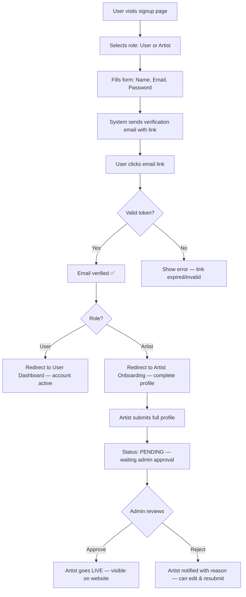

# 📋 GlamBook — PRD Overview

## Makeup Artist & Photography Listing Platform

**Version**: 1.0  
**Date**: September 29, 2026  
**Status**: Draft — Awaiting Approval

---

## 📁 PRD File Structure

| File | Contents |
|------|----------|
| **PRD_Overview.md** (this file) | Product vision, tech stack, roles, business rules, timeline |
| **PRD_Backend.md** | Database schema (17 tables), ~90+ API endpoints, auth system, security, deployment |
| **PRD_Frontend_Website.md** | 7 public website pages, SEO, responsive design, UI layouts |
| **PRD_Portals.md** | Admin Panel + Artist Portal + User Portal — all dashboard features & flows |

---

## 1. Product Overview

### 1.1 What Is GlamBook?

GlamBook is a listing & discovery platform where:
- **Artists** (Makeup Artists, Photographers, etc.) register, showcase portfolios, set availability, and receive booking requests
- **Users** search, filter, view artist profiles/portfolios, and send booking requests
- **Admin** controls everything — approves artists, manages categories, receives full booking details, and acts as the middleman between users and artists

### 1.2 Core Business Rules

| Rule | Details |
|------|---------|
| **No Payment Integration** | No online payments. Admin controls leads manually |
| **Lead Protection** | Artist receives booking request with user name + requirements only — **NO user contact info** |
| **Admin Gets Full Data** | Admin receives complete user details (name, email, phone, location) + booking requirements |
| **Artist Approval** | Every artist must be approved by admin before going live |
| **Category Control** | Only admin creates/manages categories and sub-categories |
| **Auth Method** | Email + Password with email verification link (no OTP, no social login) |

### 1.3 Platform Structure

```
GlamBook
├── 🌐 Public Website (No login required to browse)
│   ├── Home
│   ├── Find Artist
│   ├── Packages
│   ├── How It Works
│   ├── About Us
│   ├── Contact Us
│   └── Blog
│
├── 👤 User Portal (Login required)
│   ├── Dashboard
│   ├── My Bookings
│   ├── Favorites
│   ├── Profile Settings
│   └── Notifications
│
├── 🎨 Artist Portal (Login required + Admin approved)
│   ├── Dashboard
│   ├── Profile & Portfolio Management
│   ├── Services & Pricing
│   ├── Availability Calendar
│   ├── Booking Requests
│   ├── Packages
│   └── Reviews
│
└── 🛡️ Admin Panel (Super admin login)
    ├── Dashboard & Analytics
    ├── Artist Management (Approve/Reject/Suspend)
    ├── User Management
    ├── Category & Sub-Category Management
    ├── Booking Management
    ├── Content Management (Blog, Banners, Pages)
    ├── Reviews Moderation
    └── Platform Settings
```

---

## 2. Tech Stack

| Layer | Technology | Purpose |
|-------|-----------|---------|
| **Framework** | Next.js 15 (App Router) | Full-stack — SSR website + API + Portals |
| **Language** | TypeScript | Type safety across entire codebase |
| **Styling** | Tailwind CSS v4 + shadcn/ui | Modern, premium UI |
| **Database** | PostgreSQL via Supabase | Relational data, geo-queries, auth |
| **ORM** | Prisma | Type-safe database access, migrations |
| **Auth** | Supabase Auth | Email + password, email verification |
| **File Storage** | Supabase Storage or Cloudinary | Portfolio images, documents |
| **Search** | PostgreSQL Full-Text Search (MVP) → Meilisearch (later) | Artist search & filtering |
| **Calendar** | FullCalendar (frontend) + custom backend | Availability management |
| **Maps** | Google Maps API or Leaflet (free) | Location display & search |
| **Email** | Resend | Email verification, booking notifications |
| **Hosting** | Vercel | Frontend + API deployment |
| **Cache** | Upstash Redis | Session cache, rate limiting |

---

## 3. User Roles & Permissions

| Action | Public | User | Artist | Admin |
|--------|--------|------|--------|-------|
| Browse website & artist profiles | ✅ | ✅ | ✅ | ✅ |
| View portfolio & reviews | ✅ | ✅ | ✅ | ✅ |
| Register / Login | ✅ | ✅ | ✅ | ✅ |
| Send booking request | ❌ | ✅ | ❌ | ✅ |
| Save favorite artists | ❌ | ✅ | ❌ | ❌ |
| Create/edit own profile | ❌ | ✅ | ✅ | ✅ |
| Manage portfolio | ❌ | ❌ | ✅ | ✅ |
| Set availability | ❌ | ❌ | ✅ | ✅ |
| View booking (limited — no user contact) | ❌ | ❌ | ✅ | ✅ |
| View booking (full details) | ❌ | ❌ | ❌ | ✅ |
| Approve/reject artists | ❌ | ❌ | ❌ | ✅ |
| Manage categories | ❌ | ❌ | ❌ | ✅ |
| Manage all users | ❌ | ❌ | ❌ | ✅ |
| Manage blog/content | ❌ | ❌ | ❌ | ✅ |
| Platform settings | ❌ | ❌ | ❌ | ✅ |

---

## 4. Auth Flow



---

## 5. Development Phases & Timeline

| Phase | Scope | Duration |
|-------|-------|----------|
| **Phase 1** | Foundation & Backend Core (project setup, 17 DB tables, auth, utilities) | Week 1-2 |
| **Phase 2** | Admin Panel (dashboard, categories, artist approvals, user/booking management, blog) | Week 3-4 |
| **Phase 3** | Artist Portal (onboarding, portfolio, calendar, booking requests, packages) | Week 5-6 |
| **Phase 4** | User Portal (signup, booking flow, reviews, favorites, notifications) | Week 7-8 |
| **Phase 5** | Public Website (7 pages, search/filter, SEO, responsive design) | Week 9-11 |
| **Phase 6** | Integration, Testing, Performance, Security, Deployment | Week 12-14 |

**Total: ~14 weeks** (solo developer) / **~8-9 weeks** (team of 2-3)

---

## 6. Next.js Folder Structure

```
glambook/
├── src/
│   ├── app/
│   │   ├── (website)/              # Public website routes
│   │   │   ├── page.tsx            # Home
│   │   │   ├── find-artist/        # Search & filter
│   │   │   ├── artist/[slug]/      # Artist profile
│   │   │   ├── packages/           # Packages listing
│   │   │   ├── how-it-works/
│   │   │   ├── about/
│   │   │   ├── contact/
│   │   │   └── blog/
│   │   ├── (auth)/                 # Login, signup
│   │   │   ├── login/
│   │   │   ├── signup/
│   │   │   └── verify-email/
│   │   ├── user/                   # User portal (protected)
│   │   │   ├── dashboard/
│   │   │   ├── bookings/
│   │   │   ├── favorites/
│   │   │   ├── profile/
│   │   │   └── notifications/
│   │   ├── artist/                 # Artist portal (protected)
│   │   │   ├── dashboard/
│   │   │   ├── onboarding/
│   │   │   ├── portfolio/
│   │   │   ├── calendar/
│   │   │   ├── bookings/
│   │   │   ├── packages/
│   │   │   ├── reviews/
│   │   │   └── profile/
│   │   ├── admin/                  # Admin panel (protected)
│   │   │   ├── dashboard/
│   │   │   ├── artists/
│   │   │   ├── users/
│   │   │   ├── categories/
│   │   │   ├── bookings/
│   │   │   ├── content/
│   │   │   ├── blog/
│   │   │   ├── reviews/
│   │   │   └── settings/
│   │   ├── api/                    # API routes
│   │   │   ├── auth/
│   │   │   ├── artists/
│   │   │   ├── bookings/
│   │   │   ├── categories/
│   │   │   ├── reviews/
│   │   │   ├── upload/
│   │   │   └── admin/
│   │   └── layout.tsx
│   ├── components/                 # Shared components
│   │   ├── ui/                     # shadcn/ui components
│   │   ├── layout/                 # Header, Footer, Sidebar
│   │   ├── forms/                  # Reusable form components
│   │   └── shared/                 # Cards, badges, etc.
│   ├── lib/                        # Utilities
│   │   ├── supabase.ts             # Supabase client
│   │   ├── prisma.ts               # Prisma client
│   │   ├── auth.ts                 # Auth helpers
│   │   ├── email.ts                # Resend email service
│   │   ├── upload.ts               # File upload utility
│   │   └── utils.ts                # General utilities
│   ├── hooks/                      # Custom React hooks
│   ├── types/                      # TypeScript types
│   └── styles/                     # Global styles
├── prisma/
│   └── schema.prisma               # Database schema
├── public/                         # Static assets
└── package.json
```

---

## 7. Scope Summary

| Metric | Count |
|--------|-------|
| **Database Tables** | 17 |
| **API Endpoints** | ~90+ |
| **Public Website Pages** | 7 |
| **User Portal Pages** | 5 |
| **Artist Portal Pages** | 8 |
| **Admin Modules** | 10+ |
| **Development Phases** | 6 |

---

> **See detailed specs in:**
> - [PRD_Backend.md](./PRD_Backend.md) — Database, APIs, Auth, Security, Deployment
> - [PRD_Frontend_Website.md](./PRD_Frontend_Website.md) — Public website pages & design
> - [PRD_Portals.md](./PRD_Portals.md) — Admin, Artist & User portals
