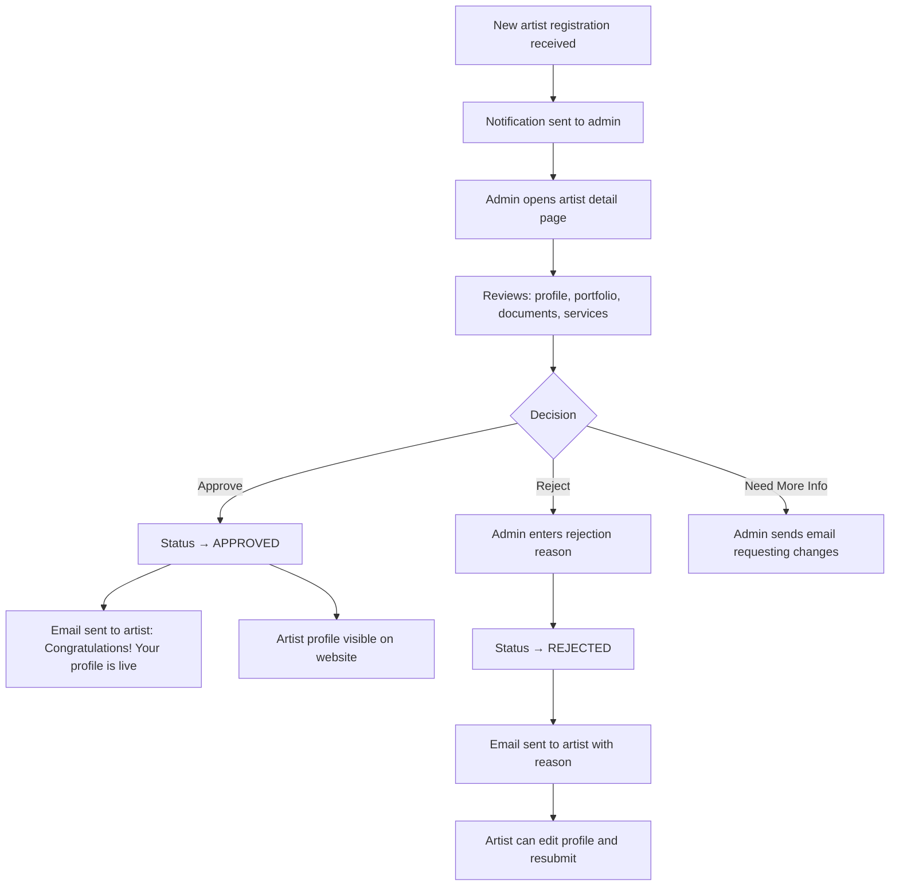
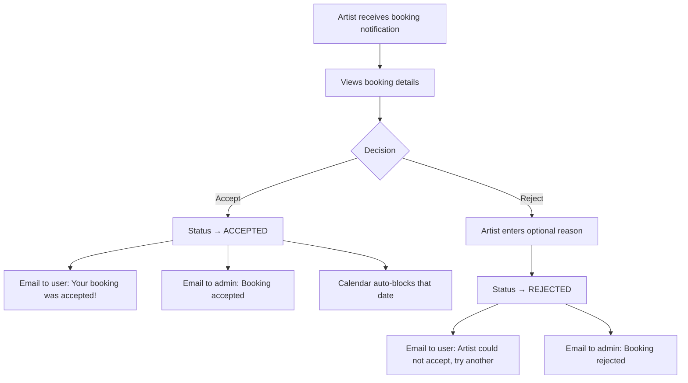

# 📋 GlamBook — PRD Portals

## Admin Panel + Artist Portal + User Portal

---

## 1. Admin Panel

### 1.1 Admin Auth & Layout

| Component | Details |
|-----------|---------|
| **Admin Login Page** | Separate login at `/admin/login` — only users with `role: admin` can access |
| **Admin Layout** | Sidebar navigation + top header with admin name, notifications bell, logout |
| **Sidebar Menu** | Dashboard, Artists, Users, Categories, Bookings, Content, Blog, Reviews, Settings |
| **Responsive** | Collapsible sidebar on mobile, hamburger menu |
| **Theme** | Dark sidebar + light content area, professional look |

### 1.2 Admin Dashboard (`/admin/dashboard`)

| Widget | Data Shown |
|--------|-----------|
| **Stats Cards** | Total Artists (approved/pending), Total Users, Total Bookings (this month), Total Profile Views |
| **Pending Approvals Alert** | Count of artists waiting for approval — clickable |
| **Recent Bookings** | Last 10 bookings with status badges |
| **Recent Artist Signups** | Last 10 new artist registrations with status |
| **New Contact Messages** | Unread contact form submissions |
| **Charts** | Bookings trend (last 30 days), Signups trend, Bookings by category (pie chart) |

### 1.3 Category Management

#### 1.3.1 Categories List Page (`/admin/categories`)

| Feature | Details |
|---------|---------|
| **Table Columns** | Icon, Name, Slug, Sub-categories count, Status (Active/Inactive), Sort Order, Actions |
| **Actions** | Edit, Delete (only if no artists use it), Toggle Active/Inactive |
| **Add Category Button** | Opens modal/drawer |
| **Drag & Drop** | Reorder categories by dragging |
| **Bulk Actions** | Activate/Deactivate selected |

#### 1.3.2 Add/Edit Category Modal

| Field | Type | Validation |
|-------|------|-----------|
| Category Name | Text input | Required, 2-100 chars, unique |
| Slug | Text input | Auto-generated from name, editable, unique |
| Description | Textarea | Optional, max 500 chars |
| Icon | Image upload | Optional, max 500KB, SVG/PNG |
| Banner Image | Image upload | Optional, max 2MB |
| Status | Toggle | Active/Inactive |
| Sort Order | Number input | Default 0 |

#### 1.3.3 Sub-Categories Page (`/admin/categories/[id]/sub-categories`)

| Feature | Details |
|---------|---------|
| **Breadcrumb** | Categories > [Category Name] > Sub-categories |
| **Table Columns** | Name, Slug, Status, Sort Order, Artists Count, Actions |
| **Add Sub-category** | Modal with: Name, Slug (auto), Description, Status, Sort Order |
| **Actions** | Edit, Delete (only if no artists use it), Toggle status |
| **Drag & Drop** | Reorder sub-categories |

### 1.4 Artist Management

#### 1.4.1 Artists List Page (`/admin/artists`)

| Feature | Details |
|---------|---------|
| **Tabs** | All, Pending Approval, Approved, Rejected, Suspended |
| **Table Columns** | Photo, Name, Category, Location, Experience, Rating, Status, Registered Date, Actions |
| **Search** | Search by name, email, location |
| **Filters** | By category, by city, by status, by date range |
| **Actions** | View Profile, Approve, Reject, Suspend, Delete |
| **Bulk Actions** | Approve selected, Reject selected, Export CSV |
| **Pending Badge** | Red badge on tab showing count of pending artists |

#### 1.4.2 Artist Detail Page (`/admin/artists/[id]`)

| Section | Content |
|---------|---------|
| **Profile Header** | Photo, name, status badge, registered date, last active |
| **Basic Info** | Business name, bio, experience, location, contact (email, phone) |
| **Services** | Table of all services with category, sub-category, pricing |
| **Portfolio** | Gallery grid of all uploaded images/videos |
| **Documents** | Uploaded ID proofs, certificates (with preview) |
| **Availability** | Calendar view of their schedule |
| **Reviews** | List of all reviews received |
| **Booking History** | All bookings for this artist |
| **Action Buttons** | Approve, Reject (with reason textarea), Suspend, Feature/Unfeature |
| **Admin Notes** | Private notes area (only admin sees) |

#### 1.4.3 Approval Flow



### 1.5 User Management

#### 1.5.1 Users List Page (`/admin/users`)

| Feature | Details |
|---------|---------|
| **Table Columns** | Avatar, Name, Username, Email, Phone, Location, Registered Date, Status, Actions |
| **Search** | By name, email, username, phone |
| **Filters** | By status (active/inactive), by city, by date range |
| **Actions** | View, Deactivate, Delete |
| **Export** | Export user list as CSV |

#### 1.5.2 User Detail Page (`/admin/users/[id]`)

| Section | Content |
|---------|---------|
| **Profile** | All user details |
| **Booking History** | All bookings made by this user with full details |
| **Reviews Given** | All reviews this user has written |
| **Favorites** | Artists this user has saved |
| **Activity Log** | Registration date, last login, total bookings |

### 1.6 Booking Management

#### 1.6.1 Bookings List Page (`/admin/bookings`)

| Feature | Details |
|---------|---------|
| **Tabs** | All, Pending, Accepted, Completed, Cancelled |
| **Table Columns** | Booking #, User Name, **User Email**, **User Phone**, Artist Name, Service, Date, Status, Actions |
| **Key Point** | **Admin sees FULL user contact details here** |
| **Search** | By booking number, user name, artist name |
| **Filters** | By status, by date range, by category, by city |
| **Actions** | View Full Details, Change Status, Add Admin Notes |
| **Export** | Export as CSV/Excel |

#### 1.6.2 Booking Detail Page (`/admin/bookings/[id]`)

| Section | Content |
|---------|---------|
| **User Info (FULL)** | Name, email, phone, location — **all visible to admin** |
| **Artist Info** | Name, category, contact |
| **Booking Details** | Service, date, time, event type, location, requirements, number of people |
| **Status Timeline** | Visual timeline showing status changes with timestamps |
| **Admin Notes** | Private notes (add/edit) |
| **Actions** | Change status, contact user, contact artist |

### 1.7 Content Management

#### 1.7.1 Banner Management (`/admin/content/banners`)

| Feature | Details |
|---------|---------|
| **Table** | Image preview, Title, Position, Status, Schedule, Actions |
| **Add Banner** | Upload image, title, subtitle, link URL, position (home hero / home middle / find artist), schedule (start/end dates), active toggle |
| **Positions** | Home page hero slider, Home page middle section, Find Artist page top |

#### 1.7.2 Static Pages (`/admin/content/pages`)

| Page | Editable Fields |
|------|----------------|
| About Us | Rich text editor (content), cover image |
| How It Works | Steps (title + description + icon) — sortable list |
| Contact Us | Office address, phone, email, map coordinates, working hours |
| Terms & Conditions | Rich text editor |
| Privacy Policy | Rich text editor |

#### 1.7.3 Testimonials (`/admin/content/testimonials`)

| Field | Details |
|-------|---------|
| Client Name | Text |
| Client Photo | Image upload |
| Testimonial Text | Textarea |
| Rating | 1-5 stars |
| Sort Order | Number |
| Active Toggle | Show/hide on website |

### 1.8 Blog Management

#### 1.8.1 Blog Posts List (`/admin/blog`)

| Feature | Details |
|---------|---------|
| **Tabs** | All, Published, Drafts |
| **Table Columns** | Cover image, Title, Category, Tags, Status, Views, Published Date, Actions |
| **Actions** | Edit, Preview, Publish/Unpublish, Delete |
| **Search** | By title, content |

#### 1.8.2 Add/Edit Blog Post (`/admin/blog/new` or `/admin/blog/[id]/edit`)

| Field | Type | Details |
|-------|------|---------|
| Title | Text input | Required, max 300 chars |
| Slug | Text input | Auto-generated, editable |
| Excerpt | Textarea | Short summary, max 300 chars |
| Content | Rich Text Editor | Full WYSIWYG editor (TipTap or similar) |
| Cover Image | Image upload | Required for publishing |
| Category | Dropdown | Admin-defined blog categories |
| Tags | Tag input | Multiple tags, comma-separated |
| Meta Title | Text input | SEO title |
| Meta Description | Textarea | SEO description |
| Status | Toggle | Draft / Published |

### 1.9 Review Moderation (`/admin/reviews`)

| Feature | Details |
|---------|---------|
| **List** | All reviews with user name, artist name, rating, comment, date, status |
| **Filters** | By status (approved/flagged), by rating, by date |
| **Actions** | Approve, Flag/Remove, View associated booking |

### 1.10 Platform Settings (`/admin/settings`)

| Setting Group | Fields |
|---------------|--------|
| **General** | Site name, logo, favicon, tagline, footer text |
| **Contact** | Support email, phone, address |
| **Social Links** | Facebook, Instagram, YouTube, Twitter URLs |
| **Email Templates** | Customize subject + body for: welcome email, booking confirmation, artist approved, artist rejected |
| **SEO Defaults** | Default meta title, description, OG image |
| **Maintenance Mode** | Toggle site on/off with maintenance message |

---

## 2. Artist Portal

### 2.1 Artist Registration & Onboarding

#### Step 1: Account Creation (`/signup?role=artist`)

| Field | Type | Validation |
|-------|------|-----------|
| Full Name | Text | Required, 2-100 chars |
| Email | Email | Required, unique, valid format |
| Password | Password | Required, min 8 chars, 1 uppercase, 1 number |
| Confirm Password | Password | Must match password |

→ Submit → Verification email sent → Click link → Email verified → Redirect to **Artist Onboarding**

#### Step 2: Artist Onboarding (`/artist/onboarding`) — Multi-Step Form

**Step 2a: Professional Details**

| Field | Type | Validation |
|-------|------|-----------|
| Business Name | Text | Optional, max 150 chars |
| Bio / About | Textarea | Required, 50-1000 chars |
| Experience (years) | Number | Required, 0-50 |
| Phone Number | Tel input | Required, valid format |
| City | Autocomplete dropdown | Required |
| State | Auto-filled from city | Required |
| Full Address | Textarea | Optional |
| Service Radius (km) | Slider or number | Default 10, range 1-100 |
| Profile Photo | Image upload | Required, max 5MB |

**Step 2b: Select Services**

| UI Element | Details |
|-----------|---------|
| **Category Selection** | Cards with category icons — select one or more (e.g., Makeup Artist, Photographer) |
| **Sub-Category Selection** | After selecting category, checkboxes for sub-categories appear |
| **Pricing per Service** | For each selected sub-category: price type (Fixed / Starting From / Range / Negotiable) + price amount(s) + optional duration in minutes |
| **Service Description** | Optional textarea per service for additional details |

Example UI flow:
```
1. Select: ☑ Makeup Artist   ☐ Photographer   ☐ Hair Stylist
   
2. Sub-categories for Makeup Artist:
   ☑ Bridal Makeup     → Price: ₹ [15000] (Starting From) | Duration: [120] min
   ☑ Groom Makeup      → Price: ₹ [5000] - ₹ [8000] (Range) | Duration: [60] min
   ☐ Party Makeup
   ☑ Engagement Makeup  → Price: ₹ [Negotiable]
```

**Step 2c: Portfolio Upload**

| Feature | Details |
|---------|---------|
| **Upload Area** | Drag & drop zone + file picker |
| **Minimum** | 5 images required |
| **Maximum** | 50 images + 10 videos |
| **File Types** | Images: JPG, PNG, WebP (max 10MB each). Videos: MP4, MOV (max 100MB each) |
| **Auto-Thumbnail** | System generates thumbnails for faster loading |
| **Organize** | Tag images by service category |
| **Reorder** | Drag & drop to reorder images |
| **Caption** | Optional title + description per item |
| **Before/After** | Option to pair two images as before/after |

**Step 2d: Set Availability**

| Feature | Details |
|---------|---------|
| **Weekly Schedule** | Set working hours per day of week (Mon-Sun) with start/end time and working/off toggle |
| **Calendar View** | Interactive calendar to block specific dates |
| **Advance Booking** | How far in advance can clients book? (e.g., up to 6 months) |

**Step 2e: Review & Submit**

| Feature | Details |
|---------|---------|
| **Summary View** | Read-only summary of all entered details |
| **Edit Buttons** | "Edit" link next to each section to go back |
| **Terms & Conditions** | Checkbox to agree to platform T&C |
| **Submit Button** | Submit for admin review |
| **Confirmation Page** | "Your profile is under review. We'll notify you via email within 24-48 hours." |

### 2.2 Artist Dashboard (`/artist/dashboard`)

| Widget | Details |
|--------|---------|
| **Status Banner** | If pending: "Your profile is under review". If rejected: "Your profile was rejected — [reason]. Edit and resubmit." If approved: hidden |
| **Stats Cards** | Total Bookings (this month), Pending Requests, Profile Views (this month), Average Rating |
| **Recent Booking Requests** | Last 5 booking requests with user name, service, date, status — quick accept/reject buttons |
| **Profile Completion** | Progress bar showing % of profile completed (portfolio, services, availability, etc.) |
| **Quick Links** | Edit Profile, Manage Portfolio, Update Availability, View Reviews |

### 2.3 Profile Management (`/artist/profile`)

| Section | Features |
|---------|---------|
| **Basic Info** | Edit name, business name, bio, phone, location, profile photo, service radius |
| **Services** | Add/remove services, update pricing, toggle active/inactive |
| **Portfolio** | Add new images/videos, delete existing, reorder, edit captions |
| **Documents** | Upload/replace ID proof, certificates |
| **Save** | Save changes — if artist is already approved, changes go live immediately. If rejected, re-submits for review |

### 2.4 Availability Calendar (`/artist/calendar`)

| Feature | Details |
|---------|---------|
| **Monthly Calendar View** | Full month view using FullCalendar |
| **Color Coding** | 🟢 Available, 🔴 Booked, ⚫ Blocked (manually by artist) |
| **Click to Block** | Click any future date to block/unblock it |
| **Bulk Block** | Select date range to block (e.g., "going on vacation") |
| **Working Hours** | Edit weekly schedule from a side panel |
| **Booked Dates** | Show booking details on booked dates (read-only, auto-set when booking confirmed) |

### 2.5 Booking Requests (`/artist/bookings`)

| Feature | Details |
|---------|---------|
| **Tabs** | Pending, Accepted, Completed, Cancelled/Rejected |
| **Each Booking Card Shows** | |
| → User Name | ✅ Visible |
| → User Email | ❌ **HIDDEN** |
| → User Phone | ❌ **HIDDEN** |
| → Service Requested | ✅ Visible |
| → Booking Date & Time | ✅ Visible |
| → Event Type | ✅ Visible |
| → Event Location | ✅ Visible |
| → Requirements/Notes | ✅ Visible |
| → Number of People | ✅ Visible |
| → Booking Number | ✅ Visible |
| **Actions on Pending** | Accept ✅ or Reject ❌ (with optional reason) |
| **Actions on Accepted** | Mark as Completed |

> **⚠️ CRITICAL: Artist NEVER sees user's email or phone number.** Only the user's name and booking details are visible. Admin acts as the middleman.

#### What Happens When Artist Accepts/Rejects:



### 2.6 Packages Management (`/artist/packages`)

| Feature | Details |
|---------|---------|
| **List** | All created packages with name, price, included services, status |
| **Add Package** | Name, description, price, select included services (from their services list), cover image, active toggle |
| **Edit/Delete** | Update or remove packages |
| **Sort** | Drag & drop to reorder |
| **Display** | Active packages show on artist's public profile |

### 2.7 Reviews Section (`/artist/reviews`)

| Feature | Details |
|---------|---------|
| **List** | All reviews with user name, rating, comment, photos, date |
| **Stats** | Average rating, rating distribution (5⭐: XX%, 4⭐: XX%, etc.) |
| **Reply** | Artist can reply to each review (one reply per review) |
| **Filter** | By rating (1-5), by date |

---

## 3. User Portal

### 3.1 User Registration

#### Signup Page (`/signup`)

| Field | Type | Validation |
|-------|------|-----------|
| Full Name | Text | Required, 2-100 chars |
| Username | Text | Required, 3-50 chars, alphanumeric + underscore, unique |
| Email | Email | Required, valid format, unique |
| Phone Number | Tel | Required, valid format |
| Location (City) | Autocomplete dropdown | Required |
| Password | Password | Required, min 8 chars |
| Confirm Password | Password | Must match |

→ Submit → Verification email sent → Click link → Email verified → Redirect to User Dashboard

#### Login Page (`/login`)

| Field | Type |
|-------|------|
| Email | Email input |
| Password | Password input |
| Remember Me | Checkbox |
| Forgot Password? | Link |

### 3.2 User Dashboard (`/user/dashboard`)

| Widget | Details |
|--------|---------|
| **Welcome Banner** | "Welcome back, [Name]!" with profile photo |
| **Upcoming Bookings** | Cards showing next 3 upcoming bookings with artist name, service, date, status |
| **Quick Actions** | Find an Artist, View My Bookings, Edit Profile |
| **Recent Activity** | Last 5 activities (booking made, review posted, etc.) |
| **Favorite Artists** | Thumbnail carousel of saved artists |

### 3.3 Booking Flow

#### Step-by-Step Booking Process

**Step 1: Find Artist** (from public website → artist profile)

User browses, filters, and selects an artist on the public website.

**Step 2: Select Service** (on artist profile page)

| UI Element | Details |
|-----------|---------|
| **Service List** | All services offered by this artist with prices |
| **Package Option** | Or select a pre-made package |
| **Select Button** | "Book This Service" or "Book This Package" |

**Step 3: Choose Date & Time** (booking modal/page)

| UI Element | Details |
|-----------|---------|
| **Calendar** | Shows artist's available dates (green), blocked (grey), already booked (red) |
| **Only future dates** | Past dates disabled |
| **Time Preference** | Morning / Afternoon / Evening dropdown (not exact time) |
| **Note** | "Exact time will be confirmed by the artist" |

**Step 4: Provide Details**

| Field | Type | Required |
|-------|------|----------|
| Event Type | Dropdown (Wedding, Engagement, Party, Photoshoot, Other) | Yes |
| Event Location | Text input with autocomplete | Yes |
| Number of People | Number input | Yes (default 1) |
| Special Requirements | Textarea | No (max 1000 chars) |
| Reference Images | Image upload (max 3) | No |

**Step 5: Review & Confirm**

| Section | Content |
|---------|---------|
| **Artist** | Name, photo, service selected |
| **Service/Package** | Name, price |
| **Date & Time** | Selected date, time preference |
| **Event Details** | Type, location, people, requirements |
| **Your Info** | Name, email (auto-filled from profile) |
| **Confirm Button** | "Send Booking Request" |
| **Note Displayed** | "No payment required now. The artist will review your request and respond within 24 hours." |

**Step 6: Confirmation**

| Content | Details |
|---------|---------|
| **Success Message** | "Your booking request #GB-XXXXX has been sent!" |
| **What's Next** | "The artist will review and accept/reject your request. You'll receive an email notification." |
| **Track Button** | "View My Bookings" → goes to `/user/bookings` |

#### What Gets Sent Where:

| Recipient | Data They Receive |
|-----------|------------------|
| **Artist** | User name, service, date, time preference, event type, event location, requirements, number of people, reference images — ❌ **NO email, phone** |
| **Admin** | **EVERYTHING** — user name, email, phone, location + all booking details + artist info |
| **User** | Booking confirmation email with booking number and details |

### 3.4 My Bookings (`/user/bookings`)

| Feature | Details |
|---------|---------|
| **Tabs** | All, Pending, Accepted, Completed, Cancelled |
| **Booking Card** | Booking #, Artist name & photo, Service, Date, Status badge, View Details button |
| **Status Badges** | 🟡 Pending, 🟢 Accepted, 🔵 Completed, 🔴 Cancelled/Rejected |
| **Detail View** | Full booking details, artist info, status timeline |
| **Cancel** | Cancel button on Pending/Accepted bookings (with confirmation dialog) |
| **Leave Review** | "Leave a Review" button appears on Completed bookings (if no review yet) |

### 3.5 Leave a Review (`/user/bookings/[id]/review`)

| Field | Type | Validation |
|-------|------|-----------|
| Rating | Star selector (1-5) | Required |
| Comment | Textarea | Optional, max 1000 chars |
| Photos | Image upload (max 5) | Optional, max 5MB each |
| Submit | Button | |

After submission:
- Review appears on artist's public profile
- Artist's average rating recalculated
- Artist notified via email
- Admin can moderate if needed

### 3.6 Favorites (`/user/favorites`)

| Feature | Details |
|---------|---------|
| **Grid View** | Artist cards (photo, name, category, rating, location) |
| **Remove** | Heart icon toggle to remove from favorites |
| **Empty State** | "You haven't saved any artists yet. Start exploring!" with CTA to Find Artist page |
| **Click** | Opens artist's public profile |

### 3.7 Profile Settings (`/user/profile`)

| Section | Fields |
|---------|--------|
| **Personal Info** | Edit name, username, phone, location, profile photo |
| **Email** | Display email (change requires re-verification) |
| **Password** | Change password (current + new + confirm) |
| **Notifications** | Toggle email notifications: booking updates, promotional emails |
| **Delete Account** | "Delete My Account" with confirmation dialog and password verification |

### 3.8 Notifications (`/user/notifications`)

| Type | Message |
|------|---------|
| Booking Sent | "Your booking request #GB-XXXXX has been sent to [Artist Name]" |
| Booking Accepted | "Good news! [Artist Name] accepted your booking for [Date]" |
| Booking Rejected | "[Artist Name] couldn't accept your booking. Try another artist." |
| Booking Completed | "Your booking with [Artist Name] is complete. Leave a review!" |
| System | Platform announcements, updates |

| Feature | Details |
|---------|---------|
| **List View** | All notifications, newest first |
| **Read/Unread** | Visual distinction (bold = unread) |
| **Mark All Read** | Button to mark all as read |
| **Bell Icon** | In header, shows unread count badge |
| **Click** | Navigate to relevant page (booking detail, artist profile, etc.) |

---

## 4. Cross-Portal Integration Points

### 4.1 Booking Data Privacy Matrix

| Data Field | User Sees | Artist Sees | Admin Sees |
|-----------|-----------|-------------|-----------|
| User Name | ✅ Own name | ✅ | ✅ |
| User Email | ✅ Own email | ❌ **HIDDEN** | ✅ |
| User Phone | ✅ Own phone | ❌ **HIDDEN** | ✅ |
| User Location | ✅ Own location | ❌ **HIDDEN** | ✅ |
| Artist Name | ✅ | ✅ Own name | ✅ |
| Artist Contact | ❌ | ✅ Own contact | ✅ |
| Service Details | ✅ | ✅ | ✅ |
| Booking Date/Time | ✅ | ✅ | ✅ |
| Event Details | ✅ | ✅ | ✅ |
| Requirements | ✅ | ✅ | ✅ |
| Admin Notes | ❌ | ❌ | ✅ |

### 4.2 Notification Triggers

| Event | Notify User | Notify Artist | Notify Admin |
|-------|------------|---------------|-------------|
| New Booking Created | ✅ Confirmation | ✅ New request | ✅ Full details |
| Booking Accepted | ✅ Accepted | — | ✅ Status update |
| Booking Rejected | ✅ Rejected | — | ✅ Status update |
| Booking Cancelled | — | ✅ Cancelled | ✅ Status update |
| Booking Completed | ✅ Leave review | — | ✅ Status update |
| New Review | — | ✅ New review | — |
| Artist Registered | — | ✅ Under review | ✅ New approval |
| Artist Approved | — | ✅ Approved | — |
| Artist Rejected | — | ✅ Rejected + reason | — |
| Contact Form | — | — | ✅ New message |

### 4.3 Calendar Auto-Updates

| Event | Calendar Action |
|-------|----------------|
| Booking accepted | Date auto-blocked on artist calendar (status: `booked`) |
| Booking cancelled (after accept) | Date auto-unblocked (status: `available`) |
| Artist manually blocks date | Date marked as `blocked` |
| Artist manually unblocks date | Date marked as `available` |

### 4.4 Rating Recalculation

When a new review is submitted:
```
artist.avg_rating = AVG(all reviews for this artist)
artist.total_reviews = COUNT(all reviews for this artist)
```
Updated immediately after review submission.

---

## 5. Testing Scenarios

### 5.1 Auth Flows
- [ ] User signup → email verification → login → dashboard
- [ ] Artist signup → email verification → onboarding → submit → pending status
- [ ] Admin login → dashboard access
- [ ] Forgot password → reset email → new password works
- [ ] Invalid credentials → proper error messages
- [ ] Expired verification link → resend option
- [ ] Access protected route without auth → redirect to login

### 5.2 Booking Flow
- [ ] User books artist → booking appears in user's bookings (pending)
- [ ] Booking appears in artist's requests (with user name, WITHOUT contact info)
- [ ] Booking appears in admin panel (with FULL user details)
- [ ] Artist accepts → user notified, calendar blocks date
- [ ] Artist rejects → user notified, date remains available
- [ ] User cancels pending booking → artist notified
- [ ] User cancels accepted booking → artist notified, date unblocks

### 5.3 Admin Operations
- [ ] Create/edit/delete category → reflected on website
- [ ] Create/edit/delete sub-category → reflected in artist services
- [ ] Approve artist → artist visible on website, receives email
- [ ] Reject artist → artist not visible, receives email with reason
- [ ] Suspend artist → artist hidden from website
- [ ] Feature artist → appears in featured section
- [ ] Create/publish blog post → appears on blog page
- [ ] Manage banners → reflected on home page
- [ ] Deactivate user → user cannot login

### 5.4 Artist Operations
- [ ] Complete onboarding → profile submitted for review
- [ ] Edit profile after approval → changes go live
- [ ] Edit profile after rejection → resubmits for review
- [ ] Upload/delete portfolio items → reflected on public profile
- [ ] Block/unblock calendar dates → reflected on public calendar
- [ ] Accept booking → calendar auto-blocks, user notified
- [ ] Create package → visible on public profile
- [ ] Reply to review → visible on public profile

### 5.5 User Operations
- [ ] Register → verify email → login → dashboard
- [ ] Book an artist → receive confirmation → track in My Bookings
- [ ] Cancel a booking → artist notified
- [ ] Leave review after completed booking → visible on artist profile
- [ ] Add/remove favorites → reflected in favorites page
- [ ] Edit profile → changes saved
- [ ] Change password → can login with new password
- [ ] Delete account → data removed, cannot login
